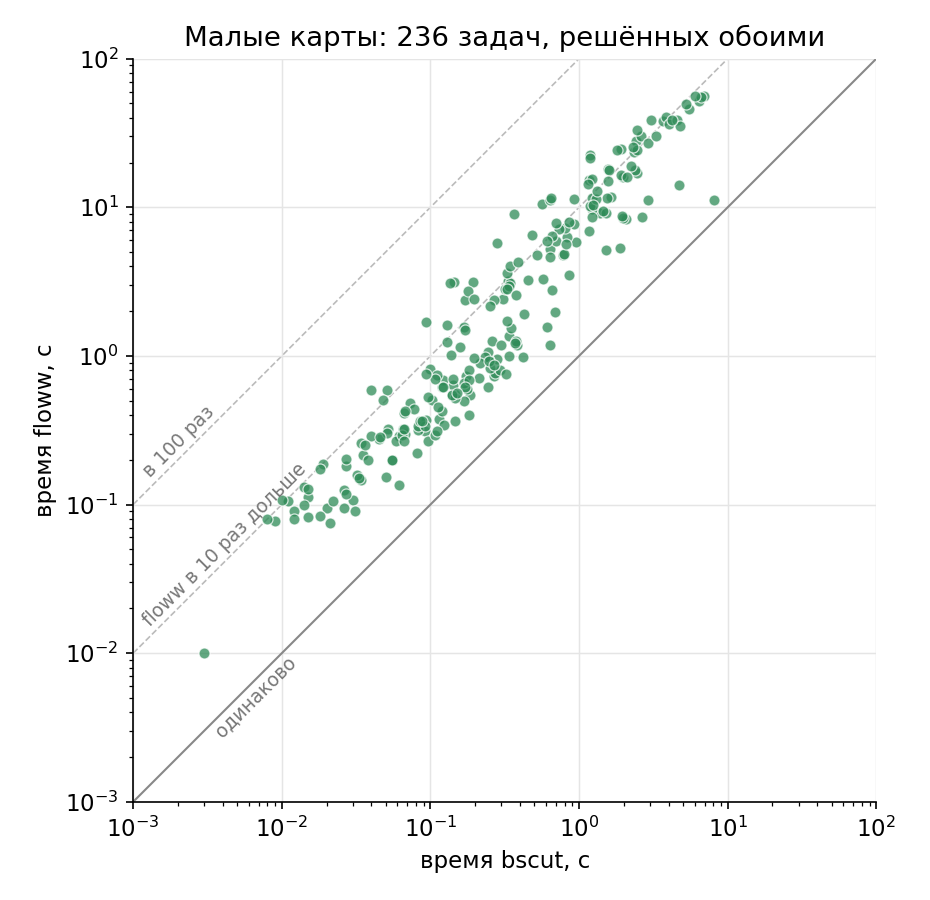

# Why bspen solves fewer instances of 3a than floww (2026-11-04)

`python small_maps_diag.py small_maps_diag.csv` (raw output: small_maps_diag.log); t-start check: small_maps_tstart.csv.
All runs sequential, cbm with `--t-start lb` (the default since 8e4a4e5; stage 5.1 ran with T from 1).

Instances: the 6 of cbm_bench_5_1.csv (maps of 3a) solved by floww in 60 s and not by bspen (group floww_only),
and 10 solved by both in 5.1, on the same maps and modes (group both).

## Measured

### 1-2. bspen --diag, 600 s

| instance | group | floww T | bspen status | time, s | root key | last key | expanded (all at key) | max depth | replans | repeated sets |
|---|---|---|---|---|---|---|---|---|---|---|
| room-32-32-4 40 g5 s3 | floww_only | 28 | timeout | 600.4 | 28 | 28 | 28:234544 | 103 | 469095 | 1213 |
| maze-32-32-2 64 k4 s2 | floww_only | 70 | timeout | 600.1 | 70 | 70 | 70:17175 | 3469 | 34354 | 0 |
| maze-32-32-2 64 g5 s2 | floww_only | 96 | timeout | 600.2 | 96 | 96 | 96:84841 | 572 | 169694 | 0 |
| maze-32-32-2 64 g5 s3 | floww_only | 114 | timeout | 600.2 | 114 | 114 | 114:95309 | 374 | 186484 | 0 |
| room-64-64-8 128 g5 s1 | floww_only | 95 | solved | 13.0 | 95 | 95 | 95:701 | 225 | 1428 | 10 |
| room-64-64-8 128 g5 s3 | floww_only | 102 | solved | 131.2 | 102 | 102 | 102:6707 | 279 | 13440 | 3807 |
| room-32-32-4 40 g5 s1 | both | 37 | solved | 0.1 | 37 | 37 | 37:9 | 9 | 26 | 0 |
| room-32-32-4 40 g5 s2 | both | 44 | solved | 0.1 | 44 | 44 | 44:23 | 23 | 54 | 0 |
| maze-32-32-2 64 k4 s1 | both | 60 | timeout | 600.2 | 60 | 60 | 60:48919 | 509 | 97841 | 0 |
| maze-32-32-2 64 k4 s3 | both | 83 | solved | 6.9 | 83 | 83 | 83:392 | 392 | 788 | 0 |
| maze-32-32-2 64 g5 s1 | both | 107 | solved | 2.8 | 107 | 107 | 107:400 | 362 | 813 | 0 |
| maze-32-32-2 40 g5 s1 | both | 107 | solved | 0.5 | 107 | 107 | 107:54 | 46 | 116 | 0 |
| maze-32-32-2 40 g5 s2 | both | 96 | timeout | 600.3 | 96 | 96 | 96:116502 | 132 | 233012 | 0 |
| room-64-64-8 64 g5 s1 | both | 95 | solved | 0.7 | 95 | 95 | 95:17 | 17 | 47 | 0 |
| room-64-64-8 64 g5 s3 | both | 102 | solved | 0.6 | 102 | 102 | 102:27 | 26 | 67 | 0 |
| room-64-64-8 128 g5 s2 | both | 85 | solved | 3.2 | 85 | 85 | 85:155 | 145 | 336 | 0 |

In all 16 instances the root key already equals the makespan of floww and every expanded node has that key
(expanded_by_key has one entry): no plateau below the answer, bspen stays at the key of the answer and does not
find a conflict-free node there.

Status changed against 5.1 (60 s, T from 1): room-64-64-8 128 g5 s1 and s3 are solved now (13 s, 131 s);
maze-32-32-2 64 k4 s1 and 40 g5 s2 (solved in 5.1) are not solved in 600 s. Check with both starts:

| instance | --t-start | limit, s | status | time, s | expanded | replans | root conflict pairs | max depth |
|---|---|---|---|---|---|---|---|---|
| maze-32-32-2 64 k4 s1 | 1 | 60 | solved | 33.5 | 2257 | 4518 | 35 | 610 |
| maze-32-32-2 64 k4 s1 | lb | 60 | timeout | 60.0 | 5068 | 10140 | 33 | 375 |
| maze-32-32-2 40 g5 s2 | 1 | 60 | solved | 1.0 | 174 | 356 | 43 | 44 |
| maze-32-32-2 40 g5 s2 | lb | 60 | timeout | 60.0 | 12009 | 24026 | 38 | 116 |
| room-64-64-8 128 g5 s1 | 1 | 600 | timeout | 600.1 | 32702 | 65430 | 181 | 366 |
| room-64-64-8 128 g5 s3 | 1 | 600 | timeout | 600.1 | 26716 | 53458 | 185 | 260 |

room-64-64-8 128 g5 with lb: see the table above (solved). The makespan is the same with both starts; only the
routes of the low level, and with them the CT, differ.

### 3. Penalty of the bspen routes minus the floww minimum on the same T

`--pen-gap S`: every replanning of the root and every S-th other one is checked by floww with the same constraints
and routes of the other teams (S = ceil(replans of bspen in 5.1 / 200)); 60 s, floww time not counted. Penalty =
weights of floww: (a) per other robot in the cell at t >= 1 (waits included), (b) per opposite move of another
robot. pen_check_failed = 0 everywhere (floww always found a flow at the T of bspen), minimum gap 0 everywhere.

| instance | group | S | checks | gap mean | gap max | share gap > 0 | bspen pen mean | min pen mean | root: checks | root: gap mean | root: gap max | root: share > 0 | root: bspen pen mean | root: min pen mean |
|---|---|---|---|---|---|---|---|---|---|---|---|---|---|---|
| room-32-32-4 40 g5 s3 | floww_only | 223 | 220 | 0.405 | 5 | 0.259 | 1.182 | 0.777 | 8 | 0.375 | 2 | 0.250 | 1.875 | 1.500 |
| maze-32-32-2 64 k4 s2 | floww_only | 22 | 226 | 7.504 | 48 | 0.929 | 13.066 | 5.562 | 4 | 11.000 | 22 | 0.750 | 15.750 | 4.750 |
| maze-32-32-2 64 g5 s2 | floww_only | 112 | 166 | 4.301 | 17 | 0.783 | 7.494 | 3.193 | 13 | 5.462 | 16 | 0.769 | 12.154 | 6.692 |
| maze-32-32-2 64 g5 s3 | floww_only | 68 | 283 | 4.283 | 24 | 0.986 | 5.385 | 1.102 | 13 | 2.538 | 10 | 0.692 | 6.308 | 3.769 |
| room-64-64-8 128 g5 s1 | floww_only | 31 | 72 | 5.069 | 21 | 0.903 | 7.653 | 2.583 | 26 | 4.038 | 21 | 0.769 | 9.615 | 5.577 |
| room-64-64-8 128 g5 s3 | floww_only | 26 | 257 | 3.043 | 32 | 0.798 | 4.868 | 1.825 | 26 | 3.346 | 32 | 0.615 | 8.115 | 4.769 |
| room-32-32-4 40 g5 s1 | both | 1 | 26 | 0.731 | 3 | 0.538 | 1.154 | 0.423 | 8 | 0.375 | 2 | 0.250 | 1.625 | 1.250 |
| room-32-32-4 40 g5 s2 | both | 1 | 54 | 1.741 | 5 | 0.778 | 1.944 | 0.204 | 8 | 1.375 | 4 | 0.625 | 1.875 | 0.500 |
| maze-32-32-2 64 k4 s1 | both | 23 | 420 | 4.531 | 48 | 0.919 | 6.714 | 2.183 | 4 | 7.000 | 18 | 0.750 | 9.000 | 2.000 |
| maze-32-32-2 64 k4 s3 | both | 5 | 161 | 7.043 | 41 | 0.801 | 8.571 | 1.528 | 4 | 3.500 | 8 | 0.750 | 5.750 | 2.250 |
| maze-32-32-2 64 g5 s1 | both | 9 | 102 | 8.431 | 32 | 0.912 | 9.716 | 1.284 | 13 | 5.231 | 14 | 0.846 | 8.692 | 3.462 |
| maze-32-32-2 40 g5 s1 | both | 1 | 116 | 3.078 | 12 | 0.845 | 3.707 | 0.629 | 8 | 2.875 | 9 | 0.750 | 6.750 | 3.875 |
| maze-32-32-2 40 g5 s2 | both | 2 | 10022 | 2.705 | 16 | 0.741 | 3.616 | 0.910 | 8 | 2.875 | 12 | 0.625 | 4.625 | 1.750 |
| room-64-64-8 64 g5 s1 | both | 1 | 47 | 1.404 | 6 | 0.660 | 2.298 | 0.894 | 13 | 0.923 | 3 | 0.462 | 3.077 | 2.154 |
| room-64-64-8 64 g5 s3 | both | 1 | 67 | 1.687 | 6 | 0.672 | 2.418 | 0.731 | 13 | 0.692 | 4 | 0.308 | 4.000 | 3.308 |
| room-64-64-8 128 g5 s2 | both | 5 | 88 | 2.886 | 25 | 0.807 | 4.216 | 1.330 | 26 | 2.615 | 25 | 0.654 | 5.808 | 3.192 |

Mean over floww_only (6): gap 4.10, share > 0 0.78, root gap 4.46, root share > 0 0.64, root conflict pairs bspen / floww 107.3 / 55.3.

Mean over both (10): gap 3.42, share > 0 0.77, root gap 2.75, root share > 0 0.60, root conflict pairs bspen / floww 47.4 / 22.5.

### 4. Root: conflicting pairs and cells of the first 20 conflicts

Free neighbours of the cell (swap: the smaller of the two): <= 2 corridor or dead end / 3 / 4 open; fewer than 20
when the root has fewer conflicts (one per cell or swapped edge and step). Map: share of all free cells.

| instance | group | pairs bspen | pairs floww | bspen <=2/3/4 | floww <=2/3/4 | map <=2/3/4 |
|---|---|---|---|---|---|---|
| room-32-32-4 40 g5 s3 | floww_only | 15 | 12 | 8/2/5 | 8/1/3 | 0.37/0.41/0.22 |
| maze-32-32-2 64 k4 s2 | floww_only | 70 | 26 | 1/9/10 | 9/7/4 | 0.17/0.74/0.10 |
| maze-32-32-2 64 g5 s2 | floww_only | 153 | 73 | 0/13/7 | 0/13/7 | 0.17/0.74/0.10 |
| maze-32-32-2 64 g5 s3 | floww_only | 84 | 56 | 8/10/2 | 6/11/3 | 0.17/0.74/0.10 |
| room-64-64-8 128 g5 s1 | floww_only | 164 | 77 | 9/1/10 | 9/1/10 | 0.09/0.37/0.53 |
| room-64-64-8 128 g5 s3 | floww_only | 158 | 88 | 6/1/13 | 7/1/12 | 0.09/0.37/0.53 |
| room-32-32-4 40 g5 s1 | both | 14 | 8 | 8/3/3 | 5/1/2 | 0.37/0.41/0.22 |
| room-32-32-4 40 g5 s2 | both | 20 | 7 | 5/10/5 | 4/1/2 | 0.37/0.41/0.22 |
| maze-32-32-2 64 k4 s1 | both | 33 | 9 | 2/14/4 | 0/9/0 | 0.17/0.74/0.10 |
| maze-32-32-2 64 k4 s3 | both | 23 | 8 | 3/15/2 | 0/6/2 | 0.17/0.74/0.10 |
| maze-32-32-2 64 g5 s1 | both | 122 | 61 | 1/15/4 | 2/15/3 | 0.17/0.74/0.10 |
| maze-32-32-2 40 g5 s1 | both | 49 | 23 | 3/16/1 | 2/14/4 | 0.17/0.74/0.10 |
| maze-32-32-2 40 g5 s2 | both | 38 | 13 | 0/16/4 | 1/9/3 | 0.17/0.74/0.10 |
| room-64-64-8 64 g5 s1 | both | 29 | 17 | 8/4/8 | 7/7/6 | 0.09/0.37/0.53 |
| room-64-64-8 64 g5 s3 | both | 26 | 19 | 7/1/12 | 6/2/12 | 0.09/0.37/0.53 |
| room-64-64-8 128 g5 s2 | both | 120 | 60 | 10/4/6 | 11/3/6 | 0.09/0.37/0.53 |

Pooled by map (share of conflicts, in brackets their number):

| map | bspen <=2/3/4 | floww <=2/3/4 | map <=2/3/4 |
|---|---|---|---|
| room-32-32-4 | 0.43/0.31/0.27 (49) | 0.63/0.11/0.26 (27) | 0.37/0.41/0.22 |
| maze-32-32-2 | 0.11/0.68/0.21 (160) | 0.15/0.65/0.20 (130) | 0.17/0.74/0.10 |
| room-64-64-8 | 0.40/0.11/0.49 (100) | 0.40/0.14/0.46 (100) | 0.09/0.37/0.53 |

## Interpretation

- Not a plateau: the root key is already optimal and the whole search runs at it. What fails is finding a
  conflict-free node among the nodes of one key, i.e. the order of expansion and the routes the low level gives.
- The penalty order of bspen is a heuristic, not a minimum: in 26-99% of the checked replannings its routes have a
  larger penalty than the floww minimum (mean gap 0.4-8.4, max 48), also in the root. In the root bspen leaves
  about twice as many conflicting pairs as floww. Each CT node then carries more conflicts to resolve.
- The gap does not separate the two groups (solved instances have similar gaps); the outcome is very sensitive to
  the routes: the same instance flips between solved in 1 s and unsolved in 600 s when only the first T of the low
  level changes (t-start 1 vs lb), in both directions. So 89 vs 94 is partly the systematic gap (more root
  conflicts) and partly this variance; 6 instances are a small sample (with lb 2 of them are solved and 2 of
  the 10 of group both are not, in 600 s).
- Cells: on the room maps the first conflicts are in cells with <= 2 free neighbours (the doors between rooms)
  far more often than such cells occur (room-64-64-8: 0.40 of the conflicts for both variants, 0.09 of the cells;
  room-32-32-4: 0.43 bspen, 0.63 floww, 0.37 of the cells). On maze-32-32-2 (corridors 2 wide, mostly 3
  neighbours) the shares follow the map. Where the conflicts are differs little between bspen and floww; how many
  differs about twofold.
- A likely source of the gap: bspen charges a penalty only on entering a cell (waits inside a bulk are free), while
  floww charges every step in a cell occupied by another robot, waits included; and the order is greedy over the
  augmenting paths, not a min-cost flow.

# Continuation (2026-11-04)

## Старт T

### Measured

`cbm_bench_cactus.py cbm_bench_cactus_tstart1.csv --maps maze-32-32-2,room-32-32-4 --variants bs,bspen --t-start 1`:
the instances of the cactus run (scen 1-10, N 20/40/60/80, teams of 5, 60 s, 8000 MB, the same stopping rule),
T of the low level from 1 instead of the lower bound. Start lb: cbm_bench_cactus.csv. 160 runs, 0.6 h.

| map | variant | solved, start lb | solved, start 1 | only lb | only 1 |
|---|---|---|---|---|---|
| maze-32-32-2 | bs | 17/40 | 17/40 | 0: - | 0: - |
| maze-32-32-2 | bspen | 19/40 | 19/40 | 2: N60 s1, N60 s8 | 2: N40 s2, N40 s9 |
| room-32-32-4 | bs | 20/40 | 18/40 | 3: N40 s5, N40 s8, N60 s1 | 1: N60 s2 |
| room-32-32-4 | bspen | 32/40 | 33/40 | 1: N80 s10 | 2: N80 s7, N80 s9 |

Makespan equal on all 82 runs solved with both starts; invalid solutions 0; no memory or killed. Every
instance solved with only one start was a timeout (not timeout_skipped) with the other start.

### Interpretation

- The start of T does not explain bspen < floww: the totals differ by at most 2 per map and variant, in both
  directions. The flips of single instances (up to 3 of 40 per variant) are the same sensitivity to the routes
  seen in "1-2" above, not a systematic effect.

## Откуда лишний штраф

### Measured

`small_maps_root.py small_maps_root.csv`; root only (`--max-nodes 1`), T from the lower bound. Penalty with the
weights of floww of every team against the teams planned before it (the routes the low level saw), summed over
the teams: wait = steps t >= 1 that stay in a cell where another robot is at t (ours entered earlier), enter =
steps t >= 1 into a cell with another robot, swap = opposite moves. Check: the bspen sum equals root pen mean x
root checks of `--pen-gap` (table 3) on all 16; root conflict pairs equal table 4.

| instance | group | bspen wait | bspen enter | bspen swap | bspen total | floww wait | floww enter | floww swap | floww total | pairs bspen / floww |
|---|---|---|---|---|---|---|---|---|---|---|
| room-32-32-4 40 g5 s3 | floww_only | 4 | 6 | 5 | 15 | 1 | 6 | 5 | 12 | 15 / 12 |
| maze-32-32-2 64 k4 s2 | floww_only | 21 | 34 | 8 | 63 | 1 | 10 | 1 | 12 | 70 / 26 |
| maze-32-32-2 64 g5 s2 | floww_only | 46 | 90 | 22 | 158 | 3 | 57 | 14 | 74 | 153 / 73 |
| maze-32-32-2 64 g5 s3 | floww_only | 22 | 46 | 14 | 82 | 0 | 45 | 10 | 55 | 84 / 56 |
| room-64-64-8 128 g5 s1 | floww_only | 33 | 169 | 48 | 250 | 1 | 108 | 23 | 132 | 164 / 77 |
| room-64-64-8 128 g5 s3 | floww_only | 16 | 148 | 47 | 211 | 2 | 79 | 27 | 108 | 158 / 88 |
| room-32-32-4 40 g5 s1 | both | 0 | 8 | 5 | 13 | 0 | 6 | 2 | 8 | 14 / 8 |
| room-32-32-4 40 g5 s2 | both | 6 | 8 | 1 | 15 | 0 | 3 | 2 | 5 | 20 / 7 |
| maze-32-32-2 64 k4 s1 | both | 6 | 21 | 9 | 36 | 1 | 7 | 1 | 9 | 33 / 9 |
| maze-32-32-2 64 k4 s3 | both | 11 | 7 | 5 | 23 | 0 | 3 | 5 | 8 | 23 / 8 |
| maze-32-32-2 64 g5 s1 | both | 29 | 63 | 21 | 113 | 1 | 38 | 11 | 50 | 122 / 61 |
| maze-32-32-2 40 g5 s1 | both | 6 | 36 | 12 | 54 | 0 | 22 | 7 | 29 | 49 / 23 |
| maze-32-32-2 40 g5 s2 | both | 21 | 12 | 4 | 37 | 0 | 7 | 3 | 10 | 38 / 13 |
| room-64-64-8 64 g5 s1 | both | 4 | 30 | 6 | 40 | 0 | 13 | 4 | 17 | 29 / 17 |
| room-64-64-8 64 g5 s3 | both | 3 | 41 | 8 | 52 | 0 | 37 | 5 | 42 | 26 / 19 |
| room-64-64-8 128 g5 s2 | both | 8 | 102 | 41 | 151 | 1 | 37 | 21 | 59 | 120 / 60 |
| **sum floww_only** | | 142 | 493 | 144 | 779 | 8 | 305 | 80 | 393 | |
| **sum both** | | 94 | 328 | 112 | 534 | 3 | 173 | 61 | 237 | |
| **sum all** | | 236 | 821 | 256 | 1313 | 11 | 478 | 141 | 630 | |

Excess of bspen over floww, all 16: wait 225, enter 343, swap 115 (of 683: 0.33, 0.50, 0.17).

### Interpretation

- The wait part is almost absent in floww (11 over 16 instances) and is 236 in bspen: Bulk Search charges
  the penalty only on entering a bulk, so staying in a cell that another robot reaches later is free for it.
  That is 33% of the excess. The rest is entries (50%) and swaps (17%): the
  greedy order over augmenting paths does not reach the minimum even for the penalties it does see.
- By map (share of the excess wait / enter / swap): maze-32-32-2 0.49 / 0.38 / 0.13 (wait the largest part in 5
  of 8 instances), room-32-32-4 0.50 / 0.39 / 0.11 (small numbers), room-64-64-8 0.17 / 0.62 / 0.20 (entries
  dominate in all 5).

## Корень от floww

### Measured

`cbm --low bspen --root-low floww`: the K calls of the root by floww, every other replanning by bspen; same
script, 60 s, T from the lower bound. Base = plain bspen in the same run (60 s). Replans include the K calls of
the root; time includes the floww root.

| instance | group | base | base: s | base: expanded | base: replans | root floww | s | expanded | generated | replans | root pairs |
|---|---|---|---|---|---|---|---|---|---|---|---|
| room-32-32-4 40 g5 s3 | floww_only | timeout | 60.0 | 22711 | 45430 | solved | 0.2 | 23 | 47 | 54 | 12 |
| maze-32-32-2 64 k4 s2 | floww_only | timeout | 60.0 | 2395 | 4793 | timeout | 60.0 | 2097 | 4195 | 4198 | 26 |
| maze-32-32-2 64 g5 s2 | floww_only | timeout | 60.0 | 8176 | 16364 | timeout | 60.0 | 8681 | 17360 | 17373 | 73 |
| maze-32-32-2 64 g5 s3 | floww_only | timeout | 60.0 | 9105 | 18034 | timeout | 60.0 | 9274 | 18549 | 18561 | 56 |
| room-64-64-8 128 g5 s1 | floww_only | solved | 13.2 | 701 | 1428 | timeout | 60.0 | 2597 | 5193 | 5219 | 77 |
| room-64-64-8 128 g5 s3 | floww_only | timeout | 60.0 | 2999 | 6024 | solved | 24.2 | 518 | 1037 | 1062 | 88 |
| room-32-32-4 40 g5 s1 | both | solved | 0.1 | 9 | 26 | solved | 0.3 | 21 | 43 | 50 | 8 |
| room-32-32-4 40 g5 s2 | both | solved | 0.1 | 23 | 54 | solved | 0.3 | 25 | 51 | 58 | 7 |
| maze-32-32-2 64 k4 s1 | both | timeout | 60.0 | 5182 | 10367 | solved | 6.8 | 396 | 793 | 796 | 9 |
| maze-32-32-2 64 k4 s3 | both | solved | 6.4 | 392 | 788 | solved | 3.9 | 31 | 63 | 66 | 8 |
| maze-32-32-2 64 g5 s1 | both | solved | 2.9 | 400 | 813 | timeout | 60.0 | 7545 | 15089 | 15102 | 61 |
| maze-32-32-2 40 g5 s1 | both | solved | 0.5 | 54 | 116 | solved | 2.8 | 92 | 185 | 192 | 23 |
| maze-32-32-2 40 g5 s2 | both | timeout | 60.0 | 11795 | 23597 | solved | 1.8 | 65 | 131 | 138 | 13 |
| room-64-64-8 64 g5 s1 | both | solved | 0.7 | 17 | 47 | solved | 9.0 | 21 | 43 | 55 | 17 |
| room-64-64-8 64 g5 s3 | both | solved | 0.6 | 27 | 67 | timeout | 60.0 | 3302 | 6603 | 6616 | 19 |
| room-64-64-8 128 g5 s2 | both | solved | 3.3 | 155 | 336 | solved | 15.8 | 291 | 583 | 608 | 60 |
| **solved floww_only** | | 1/6 | | | | 2/6 | | | | | |
| **solved both** | | 8/10 | | | | 8/10 | | | | | |

Makespan of every solved run equals floww: True. Root conflict pairs with --root-low floww equal those of floww
in all 16 (same root).

### Interpretation

- A floww root does not fix the six problem instances: 2 of 6 solved (room-32-32-4 40 s3, room-64-64-8 128 s3)
  instead of 1 (room-64-64-8 128 s1, now lost); the three maze-32-32-2 instances stay unsolved with about the same
  number of nodes as the base. Over all 16: 10 vs 9, with flips in both directions (group both: gains maze 64
  k4 s1 and 40 g5 s2, loses maze 64 g5 s1 and room-64-64-8 64 s3).
- So the root with half the conflicts is not enough: after the first replannings bspen again leaves routes with
  more penalty than floww (table 3: gap > 0 in most replannings, not only the root). The difference is in every
  replanning, and on maze about half of it is the wait part, which bspen does not see at all.

# 5.2а

## Stage 1: where the extra entries come from (2026-11-09)

### Measured

`small_maps_entries.py small_maps_entries.csv`: the 16 instances, root only (`--max-nodes 1`), T from the lower
bound; `root_late` of `cbm --diag` (lateEntries in cbm.cpp). Units: penalty units (other robots in the cell at
the step), as root_pen_enter / root_pen_wait above. Every team against the teams planned before it.

A stay = maximal run of steps e..x of a robot in one cell v (exit = x, the robot is in another cell at x+1 or
x = T). "Enter later at t'" = wait in the previous cell u over e..t'-1 instead, then stay in v from t' to x as
before. Allowed if it adds no penalty (no other robot in u over e..t'-1, no other robot moving v -> u at t'-1)
and no robot of the own team is in u then.

- Entry penalty at e: **structural** if some t' in (e, x] has no other robot in v and is allowed; otherwise
  **other**, split into: pass-through (x = e, the robot leaves v at the next step, so no later entry into the
  same stay exists), no penalty-free step in (e, x], u blocked (a penalty-free t' exists but waiting in u is not
  allowed).
- Wait penalty at s (robot in v at s-1 and s, another robot in v at s): **avoidable** if the first penalty-free
  step f > s of v satisfies f <= x and entering at f is allowed; otherwise: no penalty-free step until the exit,
  u blocked, or the stay is the start cell (no u).

bspen:

| instance | group | entry pen | structural | other | other: pass-through | other: no free step | other: u blocked | wait pen | avoidable | no free step | u blocked | start cell |
|---|---|---|---|---|---|---|---|---|---|---|---|---|
| room-32-32-4 40 g5 s3 | floww_only | 6 | 0 | 6 | 6 | 0 | 0 | 4 | 1 | 1 | 2 | 0 |
| maze-32-32-2 64 k4 s2 | floww_only | 34 | 0 | 34 | 34 | 0 | 0 | 21 | 1 | 0 | 20 | 0 |
| maze-32-32-2 64 g5 s2 | floww_only | 90 | 0 | 90 | 89 | 0 | 1 | 46 | 9 | 2 | 35 | 0 |
| maze-32-32-2 64 g5 s3 | floww_only | 46 | 0 | 46 | 46 | 0 | 0 | 22 | 2 | 0 | 20 | 0 |
| room-64-64-8 128 g5 s1 | floww_only | 169 | 0 | 169 | 169 | 0 | 0 | 33 | 4 | 2 | 27 | 0 |
| room-64-64-8 128 g5 s3 | floww_only | 148 | 0 | 148 | 148 | 0 | 0 | 16 | 3 | 0 | 13 | 0 |
| room-32-32-4 40 g5 s1 | both | 8 | 0 | 8 | 8 | 0 | 0 | 0 | 0 | 0 | 0 | 0 |
| room-32-32-4 40 g5 s2 | both | 8 | 0 | 8 | 8 | 0 | 0 | 6 | 3 | 0 | 3 | 0 |
| maze-32-32-2 64 k4 s1 | both | 21 | 0 | 21 | 21 | 0 | 0 | 6 | 0 | 1 | 5 | 0 |
| maze-32-32-2 64 k4 s3 | both | 7 | 0 | 7 | 7 | 0 | 0 | 11 | 2 | 0 | 9 | 0 |
| maze-32-32-2 64 g5 s1 | both | 63 | 0 | 63 | 62 | 0 | 1 | 29 | 2 | 1 | 26 | 0 |
| maze-32-32-2 40 g5 s1 | both | 36 | 0 | 36 | 36 | 0 | 0 | 6 | 0 | 0 | 6 | 0 |
| maze-32-32-2 40 g5 s2 | both | 12 | 0 | 12 | 12 | 0 | 0 | 21 | 2 | 1 | 18 | 0 |
| room-64-64-8 64 g5 s1 | both | 30 | 0 | 30 | 30 | 0 | 0 | 4 | 1 | 1 | 2 | 0 |
| room-64-64-8 64 g5 s3 | both | 41 | 0 | 41 | 41 | 0 | 0 | 3 | 0 | 0 | 3 | 0 |
| room-64-64-8 128 g5 s2 | both | 102 | 1 | 101 | 101 | 0 | 0 | 8 | 2 | 2 | 4 | 0 |
| **sum, bspen** | | 821 | 1 | 820 | 818 | 0 | 2 | 236 | 32 | 11 | 193 | 0 |
| **sum, floww** | | 478 | 0 | 478 | 478 | 0 | 0 | 11 | 0 | 11 | 0 | 0 |

Checks (in the script, all 16, both low levels): structural + other = all entry penalties; the parts of the
waits add up; the totals equal root_pen_enter / root_pen_wait of cbm (and the table "Откуда лишний штраф").
Per-instance floww numbers: small_maps_entries.csv.

### Interpretation

- A late entry without a shift of the tail removes 1 of 821 entry penalty units and 14% of the extra waits (32
  of 236 wait penalty units); alternatives with a shift were not checked.
- By the definition (entry later into the same stay, same exit) a pass-through (e = x) has an empty (e, x], so the
  818 pass-throughs are "other" by definition, not because a later crossing was checked and found impossible.
  Waiting in u and crossing v later with the rest of the route shifted was not checked, so these numbers do not
  say how much bscut can change the entries.

## Stage 2: low level bscut (2026-11-10)

`--low bscut [--cut penal|all]` in cbm and bs_team (bs_team.hpp, `setCut`). bs and bspen are unchanged (see the
regression below).

- Same penalties as floww / bspen: (cell, step) with a robot of another team; an opposite move u -> v at t while
  another robot moves v -> u at t.
- Soft cuts of the waiting chains: `penal` (default) around every step t >= 1 with another robot in the cell (each
  such step is a piece of its own, the steps between them one piece); `all` at every step. A soft cut leaves the
  edge usable; hard blocks (flow, vertex constraints) stay as in Bulk Search. No soft cuts after a taken goal (that
  time is occupied by the team anyway) and none at the last step of the horizon.
- Pieces of one cell follow each other without a block; waiting across a soft cut is an explicit transition
  (wait into the next piece) that costs the robots in the cell at the new step.
- Entry into a piece of a neighbour: the earliest one, and, if it has an opposite move, also the earliest one in
  the same piece without (the detour of forbiddenMoves, soft). With `all` a piece is one step, so the second entry
  never exists there; the later pieces get their own earliest entry.
- OPEN as bspen: accumulated penalty, then the key of Bulk Search. A piece is expanded at its first extraction; as
  in Bulk Search, an earlier entry into a partly visited piece expands only its unvisited prefix (needed for the
  minimal T; no node is expanded twice). No (step, penalty) pairs.
- addPathEdges unchanged: a forward step inside one cell (the transition) is filled as a wait chain.

Deviations / fixes found by the checks:
- After a soft cut b the next piece is entered at max(b+1, first move from the source interval); b+1 alone gave
  an entry at the step of the source node (no move), and the flow broke.
- bscut (mostly `all`) gives swaps of two robots of one team on an edge (a valid flow without the edge gadget).
  As in cbm (removeSwapsInTeam) they are replaced by two waits; the function moved to bs_team.hpp (removeSwaps)
  and bs_team uses it too (prints the number on stderr). Same T, same cells per step, no new moves, so constraints
  and penalties can only stay or drop. bs and bspen made none in the tests below.

### Measured

| check | bs | bspen | bscut penal | bscut all |
|---|---|---|---|---|
| 2.1: minimal T = brute force, 1000 instances (`test_flow_team.py --makespan 1000`), validator | 0 / 1000 | 0 / 1000 | 0 / 1000 | 0 / 1000 |
| 2.2: with other robots (`--weights 1000`): T = brute force, validator, penalty >= minimum | | 0 / 1000 | 0 / 1000 | 0 / 1000 |
| penalty = minimum (floww), share of the 664 solved | | 0.742 | 0.834 | 0.839 |
| mean excess over the minimum (max) | | 0.684 (10) | 0.364 (9) | 0.352 (9) |
| 2.3: CBM vs brute force, 3000 instances: wrong | 0 | 0 | 0 | 0 |
| 2.3: node limit 5000 hit on a solvable instance | 14 | 12 | 10 | 9 |

- `--makespan` has no other robots, so `penal` cuts nothing there; the T of `penal` with cuts is checked by
  `--weights` (T = brute force there too) and by CBM (others = the other teams).
- floww `--weights 1000`: 0 mismatches (cost = penalty of its routes = brute minimum), as before.
- Node limit: CBM stops at 5000 CT nodes without an answer (not a wrong answer); the same instances for bs and
  bspen with the old cbm.exe.
- Regression against the exe of 2d4b024 (built from HEAD): `test_flow_team.py --makespan 1000 --lows bs,bspen` and
  `--weights 1000 --low bspen`: same summary lines; `compare_cbm.py --random 3000` for bs and bspen: same output
  (same limit instances, same CT node median / max, same pruned children); `compare_cbm_exe.py OLD NEW --low bspen`
  and `--low bs` (the 16 instances, 3000 CT nodes, all fields except timings): 16 / 16 equal for both;
  `compare_exe.py OLD NEW --quick` (bs_team, bs: T, expansions, routes): 14 / 14 equal.

Unsolved in `--weights 1000`: 336 of 1000 instances are unsolvable at any T (brute force reaches a fixpoint of its
layers, T = -1; no time or T limit in the brute force or in bs_team): 115 a start on a vertex constraint at t = 0,
40 starts and goals in different components, 181 because of the other constraints. Every low level returned T = -1
on exactly these 336 (0 mismatches), so the 664 are all solvable instances, not a limit.

### Known approximations of bscut

- (a) A piece is expanded once, at its first extraction; a later, cheaper path into its already visited beginning
  is not expanded (as in Bulk Search, only the unvisited prefix of an earlier entry is).
- (b) Negative costs of cancelling are not counted: cancelling a move or a wait of the own flow (a reverse
  residual edge) costs 0, not minus the penalty it removes; only entries and waits across soft cuts cost.
- (c) Swaps of two robots of one team on an edge are replaced by two waits (removeSwaps). Measured (replay of
  `--weights 1000`, seed 1, with a bs_team build that can skip the replacement): bscut penal 13 swaps in 13
  instances, bscut all 44 in 37, bspen 0; the penalty of the routes with and without the replacement is equal on
  all of them (never higher, never lower). In CBM (`compare_cbm.py --random 3000`) the replacement worked 43 238
  times for bscut penal and 348 360 for bscut all (0 for bs, bspen); not measured for the penalty there, by
  construction it can not grow (same cells at every step, only moves removed).

### Interpretation

- Both modes keep the minimal T and valid routes. On small instances bscut reaches the minimal penalty more often
  than bspen (0.83-0.84 vs 0.74) and halves the mean excess.
- `all` has no bulks at all and still leaves 16% of the instances above the minimum, so the rest of the excess
  comes not from the bulks but from the greedy search of one path at a time (approximations (a), (b)). `penal`
  (0.834) closes almost everything cutting can give (`all` 0.839).

## Stage 3: bscut in CBM on the 16 instances (2026-11-10)

`small_maps_cut.py small_maps_cut.csv`: the 16 instances of `small_maps_diag.csv`, variants bspen, bscut
(`--cut penal`), bscut all (`--cut all`), floww; T from the lower bound, `--time-limit 60 --mem-limit 8000`,
sequentially. Per variant one run with `--diag` (status, nodes, replans, time, root) and, for the BS variants, one
run with `--pen-gap S` (S as in `small_maps_diag.csv`, the floww time is not counted). Root penalty = root_pen_wait
+ root_pen_enter + root_pen_swap of `--diag`. Expansions per replan = `lowlevel_expansions / lowlevel_calls`
(the new cbm field, the sum of the Bulk Search expansions of all replans; floww has none).

### Measured

Summary (medians over the 16 instances; pen-gap columns are means over the instances):

| variant | solved | CT expanded | replans | ms | root pairs | replan ms median | exp. per replan (sum / sum) | pen-gap share | pen-gap mean excess |
|---|---|---|---|---|---|---|---|---|---|
| bspen | 9/16 | 550.5 | 1120.5 | 10148 | 43.5 | 4.1555 | 3129 | 0.770 | 3.683 |
| bscut | 16/16 | 6.5 | 23.5 | 737.5 | 33 | 16.611 | 26972 | 0.280 | 1.324 |
| bscut_all | 13/16 | 6.5 | 23.5 | 8637 | 34.5 | 335.156 | 499888 | 0.319 | 1.476 |
| floww | 16/16 | 5 | 20.5 | 5398 | 21 | 305.543 | — | — | — |

Share of the root penalty gap closed, (pen_bspen − pen_mode) / (pen_bspen − pen_floww):

| map | N | mode | scen | bspen | bscut penal | bscut all | floww | closed penal | closed all |
|---|---|---|---|---|---|---|---|---|---|
| room-32-32-4 | 40 | g5 | 3 | 15 | 14 | 14 | 12 | 0.33 | 0.33 |
| maze-32-32-2 | 64 | k4 | 2 | 63 | 42 | 41 | 12 | 0.41 | 0.43 |
| maze-32-32-2 | 64 | g5 | 2 | 158 | 120 | 110 | 74 | 0.45 | 0.57 |
| maze-32-32-2 | 64 | g5 | 3 | 82 | 67 | 65 | 55 | 0.56 | 0.63 |
| room-64-64-8 | 128 | g5 | 1 | 250 | 138 | 180 | 132 | 0.95 | 0.59 |
| room-64-64-8 | 128 | g5 | 3 | 211 | 145 | 143 | 108 | 0.64 | 0.66 |
| room-32-32-4 | 40 | g5 | 1 | 13 | 10 | 7 | 8 | 0.60 | 1.20 |
| room-32-32-4 | 40 | g5 | 2 | 15 | 9 | 9 | 5 | 0.60 | 0.60 |
| maze-32-32-2 | 64 | k4 | 1 | 36 | 22 | 31 | 9 | 0.52 | 0.19 |
| maze-32-32-2 | 64 | k4 | 3 | 23 | 17 | 15 | 8 | 0.40 | 0.53 |
| maze-32-32-2 | 64 | g5 | 1 | 113 | 64 | 75 | 50 | 0.78 | 0.60 |
| maze-32-32-2 | 40 | g5 | 1 | 54 | 33 | 39 | 29 | 0.84 | 0.60 |
| maze-32-32-2 | 40 | g5 | 2 | 37 | 27 | 28 | 10 | 0.37 | 0.33 |
| room-64-64-8 | 64 | g5 | 1 | 40 | 19 | 29 | 17 | 0.91 | 0.48 |
| room-64-64-8 | 64 | g5 | 3 | 52 | 45 | 42 | 42 | 0.70 | 1.00 |
| room-64-64-8 | 128 | g5 | 2 | 151 | 115 | 116 | 59 | 0.39 | 0.38 |

- Pooled (sums over the 16: bspen 1313, bscut penal 887, bscut all 944, floww 630): penal closes 0.62 of the gap,
  all 0.54.
- Per instance: penal median 0.58 (0.33-0.95), all median 0.58 (0.19-1.20). penal closes more than all on 7
  instances, less on 7, equal on 2.
- Closed > 1 (room-32-32-4 N40 scen 1, all 7 < floww 8): the root of each mode is planned against the paths of the
  other teams from the same mode, so floww is not a lower bound for the root of another mode.

Per instance:

| map | N | mode | scen | variant | status | CT expanded | replans | ms | root pairs | root pen w/e/s = sum | pen-gap share / mean | replan ms median | exp. per replan |
|---|---|---|---|---|---|---|---|---|---|---|---|---|---|
| room-32-32-4 | 40 | g5 | 3 | bspen | timeout | 21769 | 43546 | 60043 | 15 | 4/6/5 = 15 | 0.250 / 0.396 (timeout) | 1.089 | 1484 |
| room-32-32-4 | 40 | g5 | 3 | bscut | solved | 6 | 20 | 66 | 15 | 2/7/5 = 14 | 0.125 / 0.125 | 2.967 | 2553 |
| room-32-32-4 | 40 | g5 | 3 | bscut_all | solved | 5 | 18 | 389 | 15 | 1/7/6 = 14 | 0.250 / 0.250 | 19.733 | 23748 |
| room-32-32-4 | 40 | g5 | 3 | floww | solved | 5 | 18 | 233 | 12 | 1/6/5 = 12 | — | 13.947 | — |
| maze-32-32-2 | 64 | k4 | 2 | bspen | timeout | 2378 | 4759 | 60014 | 70 | 21/34/8 = 63 | 0.932 / 7.484 (timeout) | 8.915 | 11435 |
| maze-32-32-2 | 64 | k4 | 2 | bscut | solved | 6 | 16 | 517 | 54 | 9/26/7 = 42 | 0.500 / 6.000 | 30.590 | 19897 |
| maze-32-32-2 | 64 | k4 | 2 | bscut_all | solved | 3 | 10 | 4641 | 52 | 7/32/2 = 41 | 0.500 / 5.500 | 494.015 | 425772 |
| maze-32-32-2 | 64 | k4 | 2 | floww | solved | 3 | 10 | 5241 | 26 | 1/10/1 = 12 | — | 478.651 | — |
| maze-32-32-2 | 64 | g5 | 2 | bspen | timeout | 8272 | 16556 | 60019 | 153 | 46/90/22 = 158 | 0.783 / 4.373 (timeout) | 2.866 | 2567 |
| maze-32-32-2 | 64 | g5 | 2 | bscut | solved | 12 | 37 | 1354 | 110 | 25/76/19 = 120 | 0.615 / 2.692 | 15.060 | 23232 |
| maze-32-32-2 | 64 | g5 | 2 | bscut_all | solved | 10 | 33 | 9051 | 107 | 28/64/18 = 110 | 0.615 / 2.692 | 179.774 | 252801 |
| maze-32-32-2 | 64 | g5 | 2 | floww | solved | 9 | 31 | 4905 | 73 | 3/57/14 = 74 | — | 129.652 | — |
| maze-32-32-2 | 64 | g5 | 3 | bspen | timeout | 9136 | 18095 | 60020 | 84 | 22/46/14 = 82 | 0.986 / 4.293 (timeout) | 2.460 | 2274 |
| maze-32-32-2 | 64 | g5 | 3 | bscut | solved | 17 | 47 | 1051 | 63 | 9/50/8 = 67 | 0.154 / 0.769 | 18.293 | 10975 |
| maze-32-32-2 | 64 | g5 | 3 | bscut_all | solved | 12 | 37 | 8703 | 74 | 10/41/14 = 65 | 0.231 / 0.692 | 245.500 | 203169 |
| maze-32-32-2 | 64 | g5 | 3 | floww | solved | 16 | 45 | 8373 | 56 | 0/45/10 = 55 | — | 226.868 | — |
| room-64-64-8 | 128 | g5 | 1 | bspen | solved | 701 | 1428 | 13644 | 164 | 33/169/48 = 250 | 0.903 / 5.069 | 7.608 | 8704 |
| room-64-64-8 | 128 | g5 | 1 | bscut | solved | 18 | 62 | 4007 | 90 | 6/100/32 = 138 | 0.179 / 0.643 | 25.464 | 43928 |
| room-64-64-8 | 128 | g5 | 1 | bscut_all | timeout | 13 | 52 | 60007 | 105 | 11/140/29 = 180 | 0.296 / 1.185 (timeout) | 916.037 | 847570 |
| room-64-64-8 | 128 | g5 | 1 | floww | solved | 18 | 62 | 42208 | 77 | 1/108/23 = 132 | — | 716.269 | — |
| room-64-64-8 | 128 | g5 | 3 | bspen | timeout | 2863 | 5751 | 60006 | 158 | 16/148/47 = 211 | 0.798 / 3.097 (timeout) | 8.669 | 9864 |
| room-64-64-8 | 128 | g5 | 3 | bscut | solved | 19 | 64 | 4345 | 110 | 3/103/39 = 145 | 0.370 / 1.037 | 30.835 | 41479 |
| room-64-64-8 | 128 | g5 | 3 | bscut_all | timeout | 14 | 53 | 60007 | 116 | 8/90/45 = 143 | 0.370 / 1.296 (timeout) | 1019.429 | 799106 |
| room-64-64-8 | 128 | g5 | 3 | floww | solved | 19 | 64 | 46390 | 88 | 2/79/27 = 108 | — | 802.784 | — |
| room-32-32-4 | 40 | g5 | 1 | bspen | solved | 9 | 26 | 55 | 14 | 0/8/5 = 13 | 0.538 / 0.731 | 1.441 | 2777 |
| room-32-32-4 | 40 | g5 | 1 | bscut | solved | 4 | 16 | 82 | 11 | 0/7/3 = 10 | 0.000 / 0.000 | 3.550 | 4676 |
| room-32-32-4 | 40 | g5 | 1 | bscut_all | solved | 4 | 16 | 754 | 8 | 2/3/2 = 7 | 0.000 / 0.000 | 41.866 | 52118 |
| room-32-32-4 | 40 | g5 | 1 | floww | solved | 3 | 14 | 360 | 8 | 0/6/2 = 8 | — | 27.490 | — |
| room-32-32-4 | 40 | g5 | 2 | bspen | solved | 23 | 54 | 108 | 20 | 6/8/1 = 15 | 0.778 / 1.741 | 1.135 | 1763 |
| room-32-32-4 | 40 | g5 | 2 | bscut | solved | 3 | 14 | 91 | 13 | 2/6/1 = 9 | 0.214 / 0.357 | 4.765 | 5972 |
| room-32-32-4 | 40 | g5 | 2 | bscut_all | solved | 4 | 16 | 1008 | 15 | 3/5/1 = 9 | 0.188 / 0.375 | 57.998 | 64400 |
| room-32-32-4 | 40 | g5 | 2 | floww | solved | 3 | 14 | 536 | 7 | 0/3/2 = 5 | — | 44.194 | — |
| maze-32-32-2 | 64 | k4 | 1 | bspen | timeout | 4866 | 9736 | 60020 | 33 | 6/21/9 = 36 | 0.920 / 4.514 (timeout) | 5.445 | 5445 |
| maze-32-32-2 | 64 | k4 | 1 | bscut | solved | 3 | 10 | 232 | 20 | 4/14/4 = 22 | 0.500 / 3.250 | 20.406 | 15335 |
| maze-32-32-2 | 64 | k4 | 1 | bscut_all | solved | 4 | 12 | 4296 | 28 | 6/17/8 = 31 | 0.500 / 4.500 | 422.448 | 328826 |
| maze-32-32-2 | 64 | k4 | 1 | floww | solved | 5 | 14 | 5555 | 9 | 1/7/1 = 9 | — | 384.217 | — |
| maze-32-32-2 | 64 | k4 | 3 | bspen | solved | 392 | 788 | 6652 | 23 | 11/7/5 = 23 | 0.801 / 7.043 | 7.937 | 6969 |
| maze-32-32-2 | 64 | k4 | 3 | bscut | solved | 2 | 8 | 299 | 17 | 3/8/6 = 17 | 0.400 / 1.400 | 27.572 | 25788 |
| maze-32-32-2 | 64 | k4 | 3 | bscut_all | solved | 2 | 8 | 4548 | 15 | 4/7/4 = 15 | 0.600 / 1.200 | 743.808 | 506954 |
| maze-32-32-2 | 64 | k4 | 3 | floww | solved | 1 | 6 | 4726 | 8 | 0/3/5 = 8 | — | 634.663 | — |
| maze-32-32-2 | 64 | g5 | 1 | bspen | solved | 400 | 813 | 2907 | 122 | 29/63/21 = 113 | 0.912 / 8.431 | 2.453 | 2690 |
| maze-32-32-2 | 64 | g5 | 1 | bscut | solved | 22 | 57 | 1781 | 81 | 13/35/16 = 64 | 0.500 / 1.722 | 15.293 | 18381 |
| maze-32-32-2 | 64 | g5 | 1 | bscut_all | solved | 12 | 37 | 12520 | 92 | 21/37/17 = 75 | 0.625 / 2.438 | 235.022 | 302450 |
| maze-32-32-2 | 64 | g5 | 1 | floww | solved | 12 | 37 | 7602 | 61 | 1/38/11 = 50 | — | 185.713 | — |
| maze-32-32-2 | 40 | g5 | 1 | bspen | solved | 54 | 116 | 481 | 49 | 6/36/12 = 54 | 0.845 / 3.078 | 2.427 | 4397 |
| maze-32-32-2 | 40 | g5 | 1 | bscut | solved | 7 | 22 | 747 | 38 | 4/22/7 = 33 | 0.273 / 0.773 | 12.697 | 24469 |
| maze-32-32-2 | 40 | g5 | 1 | bscut_all | solved | 7 | 22 | 8571 | 41 | 8/23/8 = 39 | 0.273 / 1.045 | 247.865 | 358245 |
| maze-32-32-2 | 40 | g5 | 1 | floww | solved | 5 | 18 | 4219 | 23 | 0/22/7 = 29 | — | 202.433 | — |
| maze-32-32-2 | 40 | g5 | 2 | bspen | timeout | 11679 | 23366 | 60025 | 38 | 21/12/4 = 37 | 0.740 / 2.693 (timeout) | 2.262 | 2331 |
| maze-32-32-2 | 40 | g5 | 2 | bscut | solved | 4 | 16 | 414 | 28 | 12/11/4 = 27 | 0.333 / 1.167 | 6.787 | 19479 |
| maze-32-32-2 | 40 | g5 | 2 | bscut_all | solved | 5 | 18 | 4917 | 28 | 12/12/4 = 28 | 0.308 / 1.000 | 201.116 | 258594 |
| maze-32-32-2 | 40 | g5 | 2 | floww | solved | 4 | 16 | 2685 | 13 | 0/7/3 = 10 | — | 146.873 | — |
| room-64-64-8 | 64 | g5 | 1 | bspen | solved | 17 | 47 | 732 | 29 | 4/30/6 = 40 | 0.660 / 1.404 | 7.419 | 21411 |
| room-64-64-8 | 64 | g5 | 1 | bscut | solved | 7 | 27 | 1238 | 16 | 0/16/3 = 19 | 0.000 / 0.000 | 17.929 | 39116 |
| room-64-64-8 | 64 | g5 | 1 | bscut_all | solved | 6 | 25 | 31803 | 18 | 1/25/3 = 29 | 0.080 / 0.080 | 915.743 | 952240 |
| room-64-64-8 | 64 | g5 | 1 | floww | solved | 8 | 29 | 19695 | 17 | 0/13/4 = 17 | — | 598.435 | — |
| room-64-64-8 | 64 | g5 | 3 | bspen | solved | 27 | 67 | 613 | 26 | 3/41/8 = 52 | 0.672 / 1.687 | 5.982 | 10818 |
| room-64-64-8 | 64 | g5 | 3 | bscut | solved | 6 | 25 | 728 | 21 | 0/39/6 = 45 | 0.080 / 0.080 | 13.446 | 22772 |
| room-64-64-8 | 64 | g5 | 3 | bscut_all | solved | 7 | 27 | 26242 | 21 | 0/35/7 = 42 | 0.074 / 0.074 | 1030.790 | 689415 |
| room-64-64-8 | 64 | g5 | 3 | floww | solved | 5 | 23 | 14087 | 19 | 0/37/5 = 42 | — | 555.004 | — |
| room-64-64-8 | 128 | g5 | 2 | bspen | solved | 155 | 336 | 3357 | 120 | 8/102/41 = 151 | 0.807 / 2.886 | 6.389 | 9671 |
| room-64-64-8 | 128 | g5 | 2 | bscut | solved | 21 | 68 | 3874 | 79 | 3/86/26 = 115 | 0.235 / 1.176 | 21.208 | 37716 |
| room-64-64-8 | 128 | g5 | 2 | bscut_all | timeout | 18 | 61 | 60003 | 82 | 2/89/25 = 116 | 0.188 / 1.281 (timeout) | 718.522 | 646990 |
| room-64-64-8 | 128 | g5 | 2 | floww | solved | 21 | 68 | 36012 | 60 | 1/37/21 = 59 | — | 560.443 | — |

- bspen: 7 timeouts (CT nodes in the thousands); bscut penal: 0; bscut all: 3, all on room-64-64-8 N128 (replan
  median 0.7-1.0 s, 13-18 CT nodes in 60 s); floww: 0.
- CT expanded: bscut penal 2-22, all 2-18, floww 1-21, bspen 9-21769.
- Replan cost (medians over instances): bspen 4.2 ms, penal 16.6 ms, all 335 ms, floww 306 ms; expansions per
  replan 3.1 k / 27 k / 500 k.
- Time: penal is the fastest variant on 11 of 16 instances; all is slower than floww on 13 of 16.
- pen-gap rows marked (timeout) cover the replans done before the limit.

### Interpretation

- Cutting removes most of the CT blow-up of bspen: with bscut the CT is about as small as with floww, while a replan stays
  ~20 times cheaper than a floww one. This is the best combination of the four.
- penal closes about 0.6 of the root penalty gap; all closes no more (0.54 pooled), at a ~20 times higher replan
  cost. Cutting everywhere does not pay: the cuts around the penalized steps are the ones that matter.
- The rest of the gap (about 0.4) is not about bulks (all has none): it comes from planning one path at a time
  greedily against the other teams, consistent with stage 2. Even so the remaining extra penalty does not grow the
  CT on these 16 instances.

# 5.2а, этап 4

## Part 1: cost of one replanning (2026-11-10)

`replan_cut.py replan_cut.csv`: cbm `--root-only first|last`, N = 128, teams of 5 (K = 26), scen 1, `--t-start lb`;
bs, bspen, bscut (`--cut penal`). first = team 0 (no other teams yet), last = team 25 (25 teams planned before
it). ms = time of that call (median of 3 runs, all T tried from minT); expansions = Bulk Search expansions of
the call over all T tried; hard / soft cuts = cuts of the waiting chains in the network of the final T (new
`BulkSearchTeam::countCuts`, not timed); pieces = free cells + hard + soft cuts. ms of the whole root: the 26
calls one by one (last run).

### Measured

| map | team | variant | minT | T | T tried | ms (median of 3) | expansions | hard cuts | soft cuts | pieces | ms of the whole root |
|---|---|---|---|---|---|---|---|---|---|---|---|
| room-64-64-8 | first (0) | bs | 48 | 53 | 6 | 14.2 | 22908 | 234 | 0 | 3466 | 14 |
| room-64-64-8 | first (0) | bspen | 48 | 53 | 6 | 14.9 | 22908 | 234 | 0 | 3466 | 15 |
| room-64-64-8 | first (0) | bscut | 48 | 53 | 6 | 16.9 | 22908 | 234 | 0 | 3466 | 17 |
| room-64-64-8 | last (25) | bs | 45 | 66 | 22 | 30.5 | 55088 | 136 | 0 | 3368 | 717 |
| room-64-64-8 | last (25) | bspen | 45 | 66 | 22 | 60.3 | 83929 | 148 | 0 | 3380 | 1825 |
| room-64-64-8 | last (25) | bscut | 45 | 66 | 22 | 293.4 | 191609 | 158 | 12223 | 15613 | 3129 |
| warehouse-10-20-10-2-1 | first (0) | bs | 75 | 103 | 29 | 82.8 | 181604 | 246 | 0 | 5945 | 85 |
| warehouse-10-20-10-2-1 | first (0) | bspen | 75 | 103 | 29 | 88.8 | 181604 | 246 | 0 | 5945 | 89 |
| warehouse-10-20-10-2-1 | first (0) | bscut | 75 | 103 | 29 | 93.0 | 181604 | 246 | 0 | 5945 | 93 |
| warehouse-10-20-10-2-1 | last (25) | bs | 61 | 61 | 1 | 1.9 | 2680 | 146 | 0 | 5845 | 1308 |
| warehouse-10-20-10-2-1 | last (25) | bspen | 61 | 61 | 1 | 4.9 | 2498 | 146 | 0 | 5845 | 1673 |
| warehouse-10-20-10-2-1 | last (25) | bscut | 61 | 61 | 1 | 11.7 | 4152 | 170 | 12099 | 17968 | 4048 |
| Berlin_1_256 | first (0) | bs | 155 | 180 | 26 | 1019.7 | 1301820 | 605 | 0 | 48145 | 993 |
| Berlin_1_256 | first (0) | bspen | 155 | 180 | 26 | 1088.9 | 1301820 | 605 | 0 | 48145 | 1089 |
| Berlin_1_256 | first (0) | bscut | 155 | 180 | 26 | 1178.4 | 1301820 | 605 | 0 | 48145 | 1178 |
| Berlin_1_256 | last (25) | bs | 264 | 264 | 1 | 84.7 | 92782 | 865 | 0 | 48405 | 28606 |
| Berlin_1_256 | last (25) | bspen | 264 | 264 | 1 | 106.9 | 92368 | 865 | 0 | 48405 | 35938 |
| Berlin_1_256 | last (25) | bscut | 264 | 264 | 1 | 200.4 | 97845 | 865 | 47757 | 96162 | 59864 |

- first: no other teams, so bspen and bscut search exactly as bs (same expansions and cuts); the time differs by
  5-19% (the penalty lookups).
- last: bscut makes 12 099-47 757 soft cuts (3.8 and 2.1 times the free cells of room / warehouse, 1.0 per cell on
  Berlin); the network has 2.0-4.6 times the pieces of bspen.
- last, time of the call: bscut vs bspen 4.8x on room-64-64-8 (T tried 22), 2.4x on warehouse (T tried 1), 1.9x on
  Berlin (T tried 1); expansions 2.3x, 1.7x, 1.06x.
- Whole root: bscut 3.1 s / 4.0 s / 59.9 s vs bspen 1.8 / 1.7 / 35.9 s and bs 0.7 / 1.3 / 28.6 s.

## Part 2: cactus run with bscut penal (2026-11-10)

`cbm_bench_cactus.py cbm_bench_cactus.csv --resume --variants bscut --maps ...`: bscut = `--low bscut --cut
penal`, scen 1-10, the same N, teams of 5, `--t-start lb`, 60 s, `--mem-limit 8000`, the stopping rule over N;
the rows of bs, bspen, flow, floww are those of `cbm_bench_cactus.csv` (not run again), bscut is appended to it.

### Measured: small maps

Solved of 40 per map:

| map | bs | bspen | bscut | flow | floww |
|---|---|---|---|---|---|
| empty-32-32 | 40 | 40 | 40 | 33 | 40 |
| random-32-32-10 | 39 | 40 | 40 | 32 | 40 |
| room-32-32-4 | 20 | 32 | 40 | 17 | 40 |
| maze-32-32-2 | 17 | 19 | 40 | 7 | 37 |
| random-64-64-10 | 36 | 40 | 40 | 19 | 40 |
| room-64-64-8 | 13 | 31 | 39 | 7 | 39 |
| **all small (of 240)** | **165** | **202** | **239** | **115** | **236** |

- bscut did not solve: room-64-64-8 N=160 scen 1 (timeout).
- Solved by floww and not by bscut: 0; by bscut and not by floww: 3. Solved by bspen and not by bscut: 0; by bscut
  and not by bspen: 37.
- Checks (`--summary`): makespan mismatches on the instances solved by several variants: 0; invalid solutions
  (validate.py --teams K): 0.

### Measured: all maps

Solved of 40 per map (bs, bspen, flow, floww from the earlier run; bscut new):

| map | bs | bspen | bscut | flow | floww |
|---|---|---|---|---|---|
| empty-32-32 | 40 | 40 | 40 | 33 | 40 |
| random-32-32-10 | 39 | 40 | 40 | 32 | 40 |
| room-32-32-4 | 20 | 32 | 40 | 17 | 40 |
| maze-32-32-2 | 17 | 19 | 40 | 7 | 37 |
| random-64-64-10 | 36 | 40 | 40 | 19 | 40 |
| room-64-64-8 | 13 | 31 | 39 | 7 | 39 |
| **small (of 240)** | **165** | **202** | **239** | **115** | **236** |
| warehouse-10-20-10-2-1 | 13 | 35 | 40 | 0 | 6 |
| Berlin_1_256 | 24 | 28 | 17 | 0 | 0 |
| Paris_1_256 | 21 | 23 | 13 | 0 | 0 |
| Boston_0_256 | 20 | 25 | 13 | 0 | 0 |
| **large (of 160)** | **78** | **111** | **83** | **0** | **6** |
| **all (of 400)** | **243** | **313** | **322** | **115** | **242** |

Large maps, solved of 10 per N:

| map | N | bs | bspen | bscut | floww |
|---|---|---|---|---|---|
| warehouse-10-20-10-2-1 | 64 | 10 | 10 | 10 | 6 |
| warehouse-10-20-10-2-1 | 128 | 3 | 10 | 10 | 0 |
| warehouse-10-20-10-2-1 | 192 | 0 | 9 | 10 | 0 |
| warehouse-10-20-10-2-1 | 256 | 0 | 6 | 10 | 0 |
| Berlin_1_256 | 64 | 10 | 10 | 10 | 0 |
| Berlin_1_256 | 128 | 10 | 10 | 7 | 0 |
| Berlin_1_256 | 192 | 4 | 8 | 0 | 0 |
| Berlin_1_256 | 256 | 0 | 0 | 0 | 0 |
| Paris_1_256 | 64 | 10 | 10 | 10 | 0 |
| Paris_1_256 | 128 | 8 | 8 | 3 | 0 |
| Paris_1_256 | 192 | 3 | 5 | 0 | 0 |
| Paris_1_256 | 256 | 0 | 0 | 0 | 0 |
| Boston_0_256 | 64 | 10 | 10 | 10 | 0 |
| Boston_0_256 | 128 | 10 | 10 | 3 | 0 |
| Boston_0_256 | 192 | 0 | 5 | 0 | 0 |
| Boston_0_256 | 256 | 0 | 0 | 0 | 0 |

| pair | small: only the first | small: only bscut | large: only the first | large: only bscut |
|---|---|---|---|---|
| floww / bscut | 0 | 3 | 0 | 77 |
| bspen / bscut | 0 | 37 | 33 | 5 |

- Checks (`cbm_bench_cactus.py --summary`): makespan mismatches on the 334 instances solved by several variants
  (314 of them with bscut): 0; invalid solutions: 0.
- bscut timeouts: 31 (1 room-64-64-8 N160 in the CT; 30 on Berlin / Paris / Boston at N 128-192, all before the
  root was finished: root_conflict_pairs = -1, 0 CT nodes expanded, 16-38 replannings of the root done, replan
  median 0.36-3.7 s).
- Solved city instances, medians over the scens (N 64 / 128): total time bs 14-39 s, bspen 16-40 s, bscut 22-57 s;
  CT nodes expanded bs 8.5-84.5, bspen 1.5-7.5, bscut 1-5; replan median bs 42-61 ms, bspen 90-521 ms, bscut
  186-1111 ms.
- warehouse: bscut 40/40 (N 64-256), bspen 35/40, bs 13/40, floww 6/40; at N 128 median total 5.1 s vs bspen 2.3 s,
  CT expanded 11 vs 26.

### Interpretation

- On small maps and warehouse bscut solves everything that any other variant solves (239/240 and 40/40), more
  than floww, with replans ~20 times cheaper than floww (stage 3): it keeps the small CT of floww at the cost of Bulk
  Search.
- On the city maps bscut loses to bs and bspen (43/120 vs 65 and 76): the CT is already tiny there for all BS
  variants (a few nodes), so the time is the root, and the median bscut replan costs 1.7-8.6 times the bspen one (part 1: soft
  cuts double the pieces of the network on Berlin). Every city timeout of bscut is in the root.
- So bscut pays off where the CT blows up (dense maps, many teams) and costs where it does not (large sparse maps,
  long T). The 60 s limit on cities measures the root cost, not the search.

## Part 3: cactus plots with bscut (2026-11-10)

`figures/make_cactus.py cbm_bench_cactus.csv`: all `figures/cactus_*.png/.pdf` rebuilt with a fifth line bscut
("Bulk Search с резкой", #2E8B57, solid); bs (no penalties) dashed; titles without "решено N из M"; one y scale on
every plot (0..40 per map, 0..240 small, 0..160 large); the legend is replaced by labels at the right ends of the
lines with the number of solved instances, moved apart vertically (and kept below the top) when they coincide.

# Неделя 6 (2026-11-16)

## Часть 0. Инвентаризация (без запусков)

### Что уже посчитано

| пункт | статус | где |
|---|---|---|
| 1.1 bscut против floww по времени, малые карты | данные есть, сводки нет | `cbm_bench_cactus.csv`: `total_ms` по каждой задаче, оба варианта |
| 1.2 где кончилось время у тайм-аутов больших карт | данные есть, сводки нет | `cbm_bench_cactus.csv`: `root_conflict_pairs = -1` значит «корень не достроен», `lowlevel_calls` = сколько вызовов успели. Строки `timeout_skipped` не запускались (правило остановки по N), про них сказать нечего |
| 1.3 откуда «8,6» и как в медианах учтены нерешённые | данные есть | `cbm_bench_cactus.csv` (`replan_ms_median`), `small_maps_cut.csv` (`total_ms`, у тайм-аута это примерно 60 000) |
| 2.1 разложение времени вызова по частям | нет | есть только общее время и раскрытия последнего вызова (`replan_cut.csv`, сценарий 1) и доля штрафов `pen_share` (rdtsc). Нужны счётчики по частям |
| 2.2 время корня по значениям T | частично | `replan_cut.csv`: время всего корня и число T только у первой и последней команды. По каждой команде и каждому T не записано |
| 2.3 собственный makespan каждой команды | нет | см. замечание ниже |
| 3 ленивая резка | нет | |
| 4.1, 4.2 | нет | |
| 4.3 порог 300 с | только 60 с | `cbm_bench_cactus.csv` |
| 4.4 | старые линии | `figures/cactus_*` |

### а) Что такое lb в `--t-start lb`

`bs::teamLowerBound` (bs_team.hpp:62): BFS от всех целей команды, для каждого старта команды расстояние до
ближайшей цели, lb = максимум этих расстояний. То есть «самому дальнему роботу команды нужно хотя бы столько шагов,
чтобы дойти до какой-нибудь цели». Не учитывается: что цели разные (два робота могут смотреть на одну и ту же
ближайшую цель), другие роботы своей команды и чужие команды. Считается один раз на команду (`CBM::startT`).
Нижний уровень начинает с T = max(minT, 1, lb): в корне minT = 1, в остальных узлах дерева minT = ключ родителя.

### б) Как строится корень

- K = N/5 вызовов нижнего уровня подряд, команды 0..K-1 по порядку; у команды нет ограничений, чужие маршруты
  (уже спланированные команды) дают только штрафы (bspen, bscut) и не меняют её минимальный T.
- В вызове T перебирается по одному: lb, lb+1, ..., пока поток на K роботов не найдётся. Значений T у команды
  i: T_i - lb_i + 1. Каждая команда ищет свой T от своего lb, ключ корня = max T_i.
- При переходе T -> T+1 внутри вызова (`solve`): найденные пути (поток) сохраняются; расширяется горизонт,
  добавляются вершинные ограничения до T, удлиняются ожидания в занятых целях; для каждого ещё не доведённого
  робота заново: BFS-эвристика по всей карте, очистка посещённости всех клеток, новый поиск.
- Один раз на вызов (не на T): создание `BulkSearchTeam` (несколько массивов множеств размера «число клеток»),
  копирование всех чужих маршрутов (`cbm.cpp`, `others`), хеш-таблицы штрафов `otherAt` / `otherMoves`
  (`setOtherRoutes`), у bscut ещё `softCuts`.
- Между вызовами ничего не переиспользуется.

Про догадку о резах (наблюдение по коду, не замер): bscut не строит резы «в сети по всей карте». В начале вызова он
обходит хеш-таблицу `otherAt` (все пары «шаг, клетка» с чужим роботом) и кладёт по два числа в `std::set` клетки
(`softCuts`, bs_team.hpp:192). Дальше при каждом обращении к клетке идёт `lower_bound` в этом множестве
(`nextSoftCut` / `prevSoftCut`). Списка шагов по клетке, о котором говорится в части 3, у bspen нет: bspen
смотрит в хеш-таблицу по ключу t*n+клетка. Ленивая резка в части 3 = заменить множество на отсортированный
список шагов по клетке и двоичный поиск. Число кусков и раскрытий от этого не изменится, так что выигрыш будет
только на построении и на самих поисках по множеству. Сколько это стоит, покажет 2.1.

### в) flow_team.hpp

- Максимальный поток: по одному увеличивающему пути, путь ищется BFS по всей сети (Эдмондс-Карп), путей не больше
  числа роботов команды (5).
- Минимальная стоимость (floww): последовательные кратчайшие пути, Дейкстра с потенциалами, 5 путей. Считается
  только на первом T, где поток равен K. Перед этим тот же T один раз проходит максимальным потоком, который потом
  выбрасывается (`cap` сбрасывается).
- Сеть строится заново на каждом T и в каждом вызове (`build`), как в статье. Узлы: out/in на клетку и шаг, плюс 2
  узла и до 5 рёбер «гаджета» на каждое ребро карты и шаг. Отсекаются клетки, недостижимые от старта к шагу t или
  от которых не успеть к цели.
- Места, где реализация медленнее, чем могла бы быть:
  1. `outId` / `inId` выделяются размером (T+1) x (число клеток) на каждом T, независимо от отсечения. Berlin:
     47 540 клеток, T около 264, это около 12,6 млн int на массив, два массива, около 100 МБ, заново на каждом T.
  2. Сеть с нуля на каждом T при переборе T по одному: при переходе T -> T+1 почти вся сеть та же, но строится
     заново, и поток ищется с нуля (у Bulk Search поток переносится).
  3. Хеш-таблицы весов `occupied` / `moved` по всем чужим маршрутам строятся заново на каждом T.
  4. Вершинные и рёберные запреты проверяются через `unordered_set` для каждого узла и ребра сети.
  5. Рёбра добавляются через `push_back` без `reserve`.
  Пункты 1-3 растут с T и с площадью карты. Один вызов floww в корне Berlin N=64 занимает 15-60 с (медиана
  вызова в `cbm_bench_cactus.csv`), поэтому floww на городах не дошёл до конца корня ни разу (до 4 вызовов из
  13).

### Вопросы к частям 2 и 4

- 2.3. В корне у команды нет ограничений, а штрафы меняют только порядок поиска, не T. Значит, вызов команды в
  корне уже и есть «Bulk Search одной команды без остальных», и T_i, который он находит, и есть её собственный
  оптимальный makespan. Ключ корня = max T_i. В узлах дерева нижний уровень и так стартует с ключа родителя, а он
  не меньше max T_i. Поэтому «max T_i как нижняя оценка» в таком виде ничего не сэкономит: чтобы его узнать, надо
  проделать тот же перебор T. Экономия возможна только от оценки, которая лучше lb и считается дёшево. Кандидат:
  оценка через паросочетание (bottleneck matching): каждому роботу команды назначить свою цель так, чтобы
  максимальное расстояние было минимальным. Для команды из 5 это доли миллисекунды, и эта оценка не меньше lb.
- 4.3. Berlin: не решили bspen или bscut 23 задачи, из них 4 ни разу не запускались (у обоих `timeout_skipped`),
  у остальных 19 хотя бы один вариант упёрся в 60 с. floww на Berlin не решил ни одной задачи даже при N=64
  (корень не достроен, вызов 15-60 с). При N 128-256 корень floww требует 26-52 таких вызова, 300 с на это не хватит
  (оценка). 23 задачи x 300 с для floww это почти 2 часа ожидаемых тайм-аутов.

## Часть 1. Из готовых данных (без запусков)

`python week6_part1.py`: читает `cbm_bench_cactus.csv` и `small_maps_cut.csv`, печатает таблицы, рисует
`figures/week6_time_bscut_floww.png/.pdf`.

### 1.1 Малые карты: время bscut и floww на задачах, решённых обоими

#### Измерено

Время = `total_ms` всего прогона CBM (корень и дерево вместе). Отношение = время floww / время bscut по каждой задаче.

| карта | решили оба | bscut быстрее | floww быстрее | медиана отношения | мин. | макс. | медиана bscut, мс | медиана floww, мс |
|---|---|---|---|---|---|---|---|---|
| empty-32-32 | 40 | 40 | 0 | 4,0 | 2,7 | 10 | 92 | 356 |
| random-32-32-10 | 40 | 40 | 0 | 4,4 | 2,2 | 12 | 66 | 318 |
| room-32-32-4 | 40 | 40 | 0 | 4,2 | 1,9 | 11 | 140 | 614 |
| maze-32-32-2 | 37 | 37 | 0 | 6,2 | 1,4 | 16 | 637 | 3300 |
| random-64-64-10 | 40 | 40 | 0 | 8,9 | 6,1 | 22 | 890 | 8250 |
| room-64-64-8 | 39 | 39 | 0 | 10,4 | 6,9 | 24 | 1808 | 24354 |
| **все малые** | **236** | **236** | **0** | **6,5** | **1,4** | **24** | **252** | **1205** |

Каждая точка на графике — одна задача, оси логарифмические. Все 236 точек выше диагонали «одинаково»: floww
работал дольше на каждой задаче. Большинство точек лежит между линиями «в 1 раз» и «в 10 раз», на картах 64x64 они
ближе к линии «в 10 раз».

#### Интерпретация

- bscut не только решает больше задач (239 против 236), но и на всех общих задачах быстрее: в 1,4-24 раза,
  медиана 6,5. Отношение растёт с размером карты: 4-6 на картах 32x32, 9-10 на картах 64x64. Это согласуется с
  этапом 3 (16 трудных задач): узлов дерева у bscut и floww примерно поровну, а вызов нижнего уровня у bscut в
  десятки раз дешевле.

### 1.2 Большие карты: где кончилось время

#### Измерено

«Тайм-аут: корень» = `root_conflict_pairs = -1`, то есть корень не достроен. «Тайм-аут: дерево» = корень
достроен, время кончилось в дереве ограничений. «Не запускалось» = `timeout_skipped`: тот же вариант не решил
меньшее N того же сценария, поэтому большие N не запускались. Где у таких задач кончилось бы время, неизвестно.

| карта | вариант | решено | тайм-аут: корень | тайм-аут: дерево | не запускалось |
|---|---|---|---|---|---|
| warehouse-10-20-10-2-1 | bs | 13 | 0 | 10 | 17 |
| warehouse-10-20-10-2-1 | bspen | 35 | 0 | 4 | 1 |
| warehouse-10-20-10-2-1 | bscut | 40 | 0 | 0 | 0 |
| warehouse-10-20-10-2-1 | flow | 0 | 0 | 10 | 30 |
| warehouse-10-20-10-2-1 | floww | 6 | 7 | 3 | 24 |
| Berlin_1_256 | bs | 24 | 0 | 10 | 6 |
| Berlin_1_256 | bspen | 28 | 7 | 3 | 2 |
| Berlin_1_256 | bscut | 17 | 10 | 0 | 13 |
| Berlin_1_256 | flow | 0 | 10 | 0 | 30 |
| Berlin_1_256 | floww | 0 | 10 | 0 | 30 |
| Paris_1_256 | bs | 21 | 1 | 9 | 9 |
| Paris_1_256 | bspen | 23 | 7 | 3 | 7 |
| Paris_1_256 | bscut | 13 | 10 | 0 | 17 |
| Paris_1_256 | flow | 0 | 10 | 0 | 30 |
| Paris_1_256 | floww | 0 | 10 | 0 | 30 |
| Boston_0_256 | bs | 20 | 0 | 10 | 10 |
| Boston_0_256 | bspen | 25 | 10 | 0 | 5 |
| Boston_0_256 | bscut | 13 | 10 | 0 | 17 |
| Boston_0_256 | flow | 0 | 10 | 0 | 30 |
| Boston_0_256 | floww | 0 | 10 | 0 | 30 |

- Каждая строка содержит 40 задач, других статусов (нехватка памяти, ошибка) нет.
- Проверка метки: у всех недостроенных корней вызовов не больше K и 0 раскрытых узлов дерева.
- Сколько успели до тайм-аута на корне (вызовов / K): bscut N=128 16-25 из 26, N=192 26-38 из 39; bspen N=192
  29-39 из 39, N=256 39-51 из 52 (и одна Paris N=128: 26 из 26, последний вызов прерван).
- Особый случай: Paris N=128 s3 bspen. Корень достроен (7 конфликтующих пар), но время кончилось на первых
  перепланированиях, раскрыто 0 узлов. В таблице он идёт как «дерево».
- Тайм-ауты bspen и bs в дереве на городах: bs раскрывает 25-333 узла при перепланировании около 40 мс, bspen 1-11
  узлов при 90-750 мс.

#### Интерпретация

- На городах все тайм-ауты bscut (30) и большая часть тайм-аутов bspen (24 из 30) приходятся на корень. У bs
  наоборот: 29 из 30 в дереве. Значит, на городах bspen и bscut упираются в стоимость корня, а bs в число узлов
  дерева.
- bscut не достраивает корень уже при N=128 (7 из 10 на Paris и Boston), bspen только при N >= 192 (кроме одной
  Paris N=128). То есть корень bscut дороже примерно настолько, что граница сдвигается на один шаг N.
- floww на городах не достраивает корень ни разу (до 4 вызовов из 13 при N=64), flow тоже.

### 1.3 Откуда «8,6» и как в медианах учтены нерешённые

#### Измерено

- «1,7-8,6» в части 2 (2026-11-10) — это отношения медиан по группам «карта, N»: медиана `replan_ms_median` bscut
  по решённым им сценариям, делённая на ту же медиану bspen по решённым им сценариям. Минимум 1,72 (Berlin N=64),
  максимум 8,60 (Berlin N=128: bscut 1111 мс по 7 решённым, bspen 129 мс по 10). Группы задач у числителя и
  знаменателя разные: при N=128 bscut решил меньше сценариев, чем bspen, и медианы взяты по разным задачам.
- Если брать только задачи, решённые обоими (43 задачи на городах), отношение медиан вызова по каждой задаче лежит
  в пределах 0,77-9,15, медиана 1,95. Наибольшие: Berlin N=128 s2 9,15 (1324 / 145 мс), Paris N=128 s2 8,60
  (1187 / 138 мс).
- «1,9-4,9» в таблице части 1 — другая величина: время одного вызова последней команды корня, сценарий 1, N=128.
  Berlin 1,9, warehouse 2,4, room-64-64-8 4,8 (там 22 значения T за вызов, на Berlin одно).
- Медианы времени на 16 трудных задачах (этап 3, `small_maps_cut.csv`): у тайм-аута в `total_ms` записано время
  до остановки (60 003-60 043 мс), и эти задачи входят в медиану. Тайм-аутов меньше половины (bspen 7 из 16,
  bscut_all 3, bscut 0, floww 0), поэтому медиана не зависит от того, какое число стоит у тайм-аута: если считать
  тайм-аут бесконечным временем, медианы те же (bspen 10 148, bscut 737,5, bscut_all 8637, floww 5398). Медиана
  только по решённым была бы другой (bspen 732) и неверной: она отбрасывает самые трудные задачи.

#### Интерпретация

- «8,6» — не вызов, который в 8,6 раза дороже, а отношение медиан по разным наборам задач. Честная оценка по общим
  задачам: вызов bscut на городах в среднем примерно в 2 раза дороже (медиана 1,95), в отдельных задачах до 9 раз.
  Формулировку части 2 нужно читать так.
- Медианы этапа 3 посчитаны корректно (тайм-ауты учтены как «не меньше 60 с», их меньше половины).

## Часть 2. Профиль и корень (короткие запуски)

`cbm_prof.exe` = `cbm.cpp`, собранный с `-DBS_PROFILE` (`build.ps1` теперь собирает и его). В этой сборке
нижний уровень считает такты процессора (`rdtsc`) по частям вызова и печатает их в stderr: строка `prof` на вызов,
строка `prof_T` на каждое перебранное T. Без флага макросы пустые. Проверка, что поведение не изменилось:
`compare_cbm_exe.py cbm.exe(ded567f) NEW --low bs|bspen|bscut` для обычной сборки из нового кода и для сборки с
профилем: 16 / 16 совпадают у всех трёх (все поля, кроме времён).

`week6_part2.py run` (запуски строго по одному) и `week6_part2.py report`; сырые логи в `week6_prof/`, по командам
`week6_root_teams.csv`, по T `week6_root_T.csv`. Задача: случайный сценарий 1, N = 128, команды по 5 (K = 26),
`--root-only last`, `--t-start lb`, у каждого вызова свой лимит 600 с. Berlin, room-64-64-8, warehouse: bs, bspen,
bscut, по 3 прогона (медиана). Paris и Boston: по одному прогону (для 2.3). floww: Berlin N = 64, один прогон.
Частота счётчика 3,00 ГГц; пара `rdtsc` стоит 25-36 тактов.

Важно про сборку с профилем: она медленнее обычной, потому что сами замеры стоят времени. Последний вызов
Berlin bscut 279 мс против 200 мс в обычной сборке (`replan_cut.csv`), bspen 145 против 107. Больше всего замеры
раздувают части, которые вызываются миллионы раз: поиск в множествах резов и проверки. Поэтому ниже есть строка с
оценкой этих накладных расходов, а доли в ответах даны с поправкой на неё.

### 2.1 Из чего состоит вызов последней команды корня

#### Измерено

Миллисекунды, медиана 3 прогонов. «Раскрытия» = всё время цикла поиска минус проверки, поиск резов и штрафы:
вынуть узел из очереди, перебрать соседей, сгенерировать и положить в очередь новые узлы. «Подготовка» =
копия чужих маршрутов, хеш-таблицы штрафов и создание решателя. «Разрушение решателя» = освобождение его памяти в
конце вызова. «Прочее» = время вызова минус все части.

| часть | Berlin_1_256 bspen | Berlin_1_256 bscut | room-64-64-8 bspen | room-64-64-8 bscut |
|---|---|---|---|---|
| подготовка (копия чужих маршрутов, штрафы, конструктор) | 7.0 | 7.1 | 1.6 | 1.6 |
| построение резов | 0.0 | 5.3 | 0.0 | 1.8 |
| BFS-эвристика | 5.9 | 5.6 | 1.9 | 2.1 |
| очистка посещённости | 2.0 | 5.5 | 2.1 | 5.2 |
| проверки кусков и посещённости | 10.0 | 26.0 | 6.7 | 57.6 |
| поиск в множествах резов | 0.0 | 47.7 | 0.0 | 103.5 |
| штрафы (поиск в хеш-таблице) | 23.4 | 30.0 | 9.2 | 27.0 |
| раскрытия (остальное в поиске) | 88.6 | 143.5 | 51.0 | 229.3 |
| разворот пути | 0.8 | 0.6 | 0.0 | 0.1 |
| извлечение маршрутов | 0.2 | 0.1 | 0.0 | 0.0 |
| замена обменов | 0.0 | 0.0 | 0.0 | 0.0 |
| разрушение решателя | 8.1 | 8.1 | 0.8 | 2.3 |
| прочее | 0.5 | 0.4 | 0.0 | 0.0 |
| **сумма** | **146.5** | **280.1** | **73.5** | **430.6** |
| вызов, мс (сборка с профилем) | 145.4 | 279.3 | 73.5 | 430.9 |
| вызов, мс (обычный cbm.exe, replan_cut.csv) | 106.9 | 200.4 | 60.3 | 293.4 |
| замеренных участков (проверки + поиск резов + штрафы) | 715129 | 2470952 | 553720 | 4477098 |
| оценка стоимости самих замеров (пары rdtsc), мс | 7.4 | 26.5 | 4.5 | 37.2 |
| раскрытия | 92368 | 97845 | 83929 | 191609 |
| перебрано T | 1 | 1 | 22 | 22 |

На один вызов: Berlin bspen 535 тыс. проверок и 180 тыс. штрафов; bscut 687 тыс. проверок, 1,48 млн поисков
в множествах резов и 302 тыс. штрафов. room-64-64-8: bspen 416 тыс. / 0 / 138 тыс., bscut 1,28 млн / 2,78 млн / 421 тыс.

Разница bscut - bspen в этом вызове (сборка с профилем): Berlin 133,5 мс, из них раскрытия +54,9, поиск в
множествах резов +47,7, проверки +16,0, штрафы +6,6, построение резов +5,3, очистка +3,5. room-64-64-8: 357,1 мс,
из них раскрытия +178,4, поиск в множествах резов +103,5, проверки +50,8, штрафы +17,8.

#### Интерпретация

- Построение резов дешёвое: 5,3 мс из 280 на Berlin (2 %), 1,8 из 431 на room. Догадка «время уходит на то, что
  пачки режутся заранее по всей карте» не подтверждается.
- Дорого не построение, а обращения к резам во время поиска: 1,5-2,8 млн поисков в `std::set` на вызов. Даже если
  вычесть стоимость самих замеров (около 30 тактов на каждый поиск, это примерно 15 мс на Berlin и 23 мс на room),
  остаётся примерно 33 мс на Berlin и 80 мс на room.
- Остальная разница — это больше работы на одно раскрытие. Кусков больше, поэтому у каждого раскрытия больше
  кандидатов: проверок в 1,3 раза больше на Berlin и в 3 раза на room, штрафов в 1,7 и 3 раза. На room раскрытий тоже в
  2,3 раза больше (192 тыс. против 84 тыс.), на Berlin почти столько же (98 и 92 тыс.).

### 2.2 Время корня по командам и по T

#### Измерено

Сводка по корню (медиана прогонов, сборка с профилем). T_i — минимальный T команды i, который находит её вызов.
«На T < T_i» — время на значения T, где поток для команды ещё не нашёлся («неудачные T»). Эвристика, очистка и
поиск — доли времени корня; «остальное» — подготовка, разрушение и прочее.

| карта | вариант | прогонов | корень, мс | T перебрано (сумма по командам) | на T < T_i, мс | на T = T_i, мс | доля T < T_i | эвристика | очистка | поиск | остальное |
|---|---|---|---|---|---|---|---|---|---|---|---|
| Berlin_1_256 | bs | 3 | 38858 | 1011 | 36939 | 993 | 0.95 | 0.04 | 0.04 | 0.89 | 0.02 |
| Berlin_1_256 | bspen | 3 | 49112 | 1011 | 46958 | 1238 | 0.96 | 0.03 | 0.03 | 0.92 | 0.02 |
| Berlin_1_256 | bscut | 3 | 90054 | 1011 | 86666 | 2139 | 0.96 | 0.02 | 0.02 | 0.95 | 0.01 |
| room-64-64-8 | bs | 3 | 1026 | 398 | 901 | 70 | 0.88 | 0.04 | 0.03 | 0.88 | 0.05 |
| room-64-64-8 | bspen | 3 | 1523 | 398 | 1301 | 123 | 0.85 | 0.03 | 0.03 | 0.88 | 0.06 |
| room-64-64-8 | bscut | 3 | 5002 | 398 | 4399 | 385 | 0.88 | 0.01 | 0.01 | 0.93 | 0.04 |
| warehouse-10-20-10-2-1 | bs | 3 | 2042 | 660 | 1835 | 78 | 0.90 | 0.03 | 0.04 | 0.87 | 0.06 |
| warehouse-10-20-10-2-1 | bspen | 3 | 2532 | 660 | 2287 | 89 | 0.90 | 0.02 | 0.03 | 0.88 | 0.06 |
| warehouse-10-20-10-2-1 | bscut | 3 | 6547 | 660 | 6100 | 217 | 0.93 | 0.01 | 0.02 | 0.94 | 0.04 |
| Paris_1_256 | bs | 1 | 40523 | 939 | 39106 | 1253 | 0.97 | 0.04 | 0.04 | 0.91 | 0.00 |
| Paris_1_256 | bspen | 1 | 53145 | 939 | 51261 | 1643 | 0.96 | 0.03 | 0.04 | 0.93 | 0.00 |
| Paris_1_256 | bscut | 1 | 95440 | 939 | 92049 | 3004 | 0.96 | 0.02 | 0.02 | 0.95 | 0.00 |
| Boston_0_256 | bs | 1 | 35884 | 852 | 34642 | 1090 | 0.97 | 0.04 | 0.04 | 0.91 | 0.00 |
| Boston_0_256 | bspen | 1 | 46685 | 852 | 44970 | 1464 | 0.96 | 0.03 | 0.03 | 0.93 | 0.01 |
| Boston_0_256 | bscut | 1 | 89929 | 852 | 87177 | 2379 | 0.97 | 0.02 | 0.02 | 0.96 | 0.00 |

Все 26 команд корня на трёх картах. lb, T_i и число перебранных T у bs, bspen и bscut одинаковы (проверено
скриптом): минимальный T от варианта не зависит.

#### Berlin_1_256

| команда | lb | T_i | перебрано T | мс bs | мс bspen | мс bscut | раскрытия bs | bspen | bscut |
|---|---|---|---|---|---|---|---|---|---|
| 0 | 155 | 180 | 26 | 1525.0 | 1614.4 | 2026.1 | 1301820 | 1301820 | 1301820 |
| 1 | 106 | 210 | 105 | 4079.1 | 4596.8 | 6134.5 | 3778208 | 3778280 | 3808183 |
| 2 | 125 | 162 | 38 | 848.3 | 968.4 | 1494.4 | 831670 | 869929 | 896856 |
| 3 | 109 | 233 | 125 | 3336.8 | 3979.3 | 5802.6 | 3306157 | 3317759 | 3402261 |
| 4 | 154 | 193 | 40 | 1780.1 | 2086.3 | 3139.4 | 1693387 | 1701650 | 1766338 |
| 5 | 156 | 201 | 46 | 1811.8 | 2396.7 | 3619.6 | 1659934 | 1833422 | 1965815 |
| 6 | 135 | 158 | 24 | 545.0 | 665.8 | 1036.7 | 545259 | 545569 | 575233 |
| 7 | 134 | 134 | 1 | 32.1 | 33.9 | 54.7 | 19963 | 19948 | 20554 |
| 8 | 158 | 179 | 22 | 1091.9 | 1373.3 | 2378.6 | 1074608 | 1075418 | 1151866 |
| 9 | 105 | 201 | 97 | 4183.4 | 5093.1 | 9044.6 | 4053333 | 4061531 | 4459917 |
| 10 | 210 | 226 | 17 | 728.6 | 899.3 | 1592.7 | 701831 | 701774 | 771472 |
| 11 | 207 | 207 | 1 | 35.5 | 50.3 | 76.4 | 24569 | 24424 | 27751 |
| 12 | 111 | 140 | 30 | 1126.8 | 1473.1 | 2657.5 | 1045830 | 1071786 | 1224113 |
| 13 | 151 | 177 | 27 | 665.2 | 825.1 | 1489.6 | 658010 | 659200 | 740414 |
| 14 | 121 | 213 | 93 | 4224.1 | 5616.1 | 12170.1 | 3958658 | 4318973 | 5261292 |
| 15 | 216 | 216 | 1 | 101.0 | 126.2 | 209.0 | 83945 | 83709 | 80535 |
| 16 | 109 | 136 | 28 | 646.2 | 905.9 | 1904.5 | 638342 | 681077 | 784576 |
| 17 | 109 | 169 | 61 | 1456.2 | 1981.9 | 3634.8 | 1414140 | 1418040 | 1651038 |
| 18 | 181 | 206 | 26 | 1390.7 | 1866.5 | 3975.4 | 1369692 | 1403895 | 1663171 |
| 19 | 199 | 236 | 38 | 1836.6 | 2379.6 | 4908.7 | 1744750 | 1745905 | 2038998 |
| 20 | 140 | 183 | 44 | 2502.7 | 3389.9 | 7385.4 | 2307730 | 2488547 | 2981262 |
| 21 | 187 | 187 | 1 | 25.6 | 33.5 | 130.1 | 15531 | 15526 | 36630 |
| 22 | 195 | 215 | 21 | 1336.1 | 1903.9 | 4250.2 | 1258529 | 1312076 | 1645531 |
| 23 | 93 | 162 | 70 | 2818.8 | 3753.2 | 8587.9 | 2730388 | 2775812 | 3364740 |
| 24 | 130 | 157 | 28 | 626.6 | 953.7 | 2071.1 | 612513 | 712106 | 856537 |

По T для первой команды, последней команды и команды с самым большим числом перебранных T. Миллисекунды на одно
значение T, среднее по неудачным T и значение на последнем T. «Поиск» включает разворот пути.

| команда | вариант | перебрано T | неудачные T: эвристика | очистка | поиск | последний T: эвристика | очистка | поиск | путей найдено на последнем T |
|---|---|---|---|---|---|---|---|---|---|
| первая (0) | bs | 26 | 1.70 | 2.40 | 52.83 | 1.34 | 2.49 | 33.22 | 1 |
| первая (0) | bspen | 26 | 1.75 | 2.39 | 56.46 | 1.40 | 3.53 | 42.16 | 1 |
| первая (0) | bscut | 26 | 1.71 | 2.42 | 72.70 | 1.24 | 2.62 | 39.14 | 1 |
| последняя (25) | bs | 1 | — | — | — | 5.79 | 1.46 | 88.75 | 4 |
| последняя (25) | bspen | 1 | — | — | — | 5.94 | 1.95 | 122.53 | 4 |
| последняя (25) | bscut | 1 | — | — | — | 5.61 | 5.54 | 247.84 | 4 |
| больше всех T (3) | bs | 125 | 1.47 | 1.15 | 23.30 | 1.30 | 1.25 | 32.01 | 1 |
| больше всех T (3) | bspen | 125 | 1.49 | 1.17 | 28.22 | 2.09 | 1.36 | 38.37 | 1 |
| больше всех T (3) | bscut | 125 | 1.60 | 1.23 | 42.73 | 1.44 | 1.35 | 55.33 | 1 |

#### room-64-64-8

| команда | lb | T_i | перебрано T | мс bs | мс bspen | мс bscut | раскрытия bs | bspen | bscut |
|---|---|---|---|---|---|---|---|---|---|
| 0 | 48 | 53 | 6 | 21.6 | 27.3 | 31.7 | 22908 | 22908 | 22908 |
| 1 | 44 | 56 | 13 | 39.0 | 38.0 | 65.5 | 32463 | 32727 | 35343 |
| 2 | 37 | 95 | 59 | 220.2 | 261.1 | 430.1 | 217787 | 232663 | 263342 |
| 3 | 50 | 50 | 1 | 1.8 | 3.7 | 3.5 | 1784 | 1774 | 1803 |
| 4 | 86 | 94 | 9 | 31.5 | 48.4 | 78.2 | 35683 | 44090 | 48553 |
| 5 | 22 | 34 | 13 | 14.5 | 19.7 | 43.8 | 19440 | 22585 | 27450 |
| 6 | 33 | 66 | 34 | 32.2 | 42.5 | 107.6 | 44407 | 49781 | 63720 |
| 7 | 38 | 40 | 3 | 5.1 | 9.8 | 20.5 | 5159 | 5944 | 10667 |
| 8 | 39 | 56 | 18 | 45.4 | 84.0 | 245.0 | 62091 | 88663 | 122500 |
| 9 | 59 | 59 | 1 | 6.3 | 16.0 | 17.9 | 4300 | 9838 | 6241 |
| 10 | 38 | 84 | 47 | 114.0 | 178.3 | 558.1 | 134065 | 192625 | 264314 |
| 11 | 71 | 80 | 10 | 25.7 | 42.2 | 105.7 | 35981 | 39481 | 57792 |
| 12 | 38 | 50 | 13 | 36.8 | 49.8 | 181.8 | 43745 | 55522 | 83019 |
| 13 | 31 | 67 | 37 | 93.8 | 136.0 | 622.2 | 107479 | 134668 | 232028 |
| 14 | 33 | 50 | 18 | 35.6 | 68.3 | 227.0 | 41364 | 58532 | 103124 |
| 15 | 38 | 38 | 1 | 2.1 | 9.3 | 13.8 | 2029 | 4532 | 3554 |
| 16 | 76 | 76 | 1 | 4.7 | 8.0 | 25.8 | 5406 | 7204 | 8617 |
| 17 | 38 | 71 | 34 | 85.5 | 133.8 | 521.2 | 95779 | 134972 | 250088 |
| 18 | 55 | 65 | 11 | 21.0 | 41.1 | 152.7 | 22389 | 40434 | 76490 |
| 19 | 40 | 52 | 13 | 48.9 | 67.5 | 347.3 | 47815 | 79734 | 158946 |
| 20 | 47 | 47 | 1 | 3.9 | 6.5 | 21.2 | 2674 | 4884 | 7359 |
| 21 | 52 | 81 | 30 | 74.7 | 132.8 | 672.7 | 89967 | 121968 | 291854 |
| 22 | 46 | 46 | 1 | 2.4 | 4.1 | 15.0 | 1116 | 2345 | 3963 |
| 23 | 68 | 68 | 1 | 5.2 | 8.6 | 32.5 | 3196 | 7280 | 11497 |
| 24 | 75 | 75 | 1 | 2.5 | 12.4 | 30.2 | 1239 | 9350 | 8316 |

| команда | вариант | перебрано T | неудачные T: эвристика | очистка | поиск | последний T: эвристика | очистка | поиск | путей найдено на последнем T |
|---|---|---|---|---|---|---|---|---|---|
| первая (0) | bs | 6 | 0.14 | 0.09 | 2.78 | 0.15 | 0.18 | 3.16 | 1 |
| первая (0) | bspen | 6 | 0.15 | 0.13 | 4.05 | 0.10 | 0.16 | 2.62 | 1 |
| первая (0) | bscut | 6 | 0.15 | 0.12 | 4.77 | 0.12 | 0.16 | 4.54 | 1 |
| последняя (25) | bs | 22 | 0.09 | 0.07 | 1.93 | 0.09 | 0.12 | 0.87 | 1 |
| последняя (25) | bspen | 22 | 0.08 | 0.08 | 2.91 | 0.08 | 0.12 | 3.65 | 1 |
| последняя (25) | bscut | 22 | 0.10 | 0.23 | 18.26 | 0.08 | 0.42 | 25.19 | 1 |
| больше всех T (2) | bs | 59 | 0.09 | 0.13 | 3.33 | 0.06 | 0.11 | 1.27 | 1 |
| больше всех T (2) | bspen | 59 | 0.09 | 0.13 | 3.88 | 0.07 | 0.13 | 2.36 | 1 |
| больше всех T (2) | bscut | 59 | 0.09 | 0.13 | 6.73 | 0.09 | 0.22 | 3.18 | 1 |

#### warehouse-10-20-10-2-1

| команда | lb | T_i | перебрано T | мс bs | мс bspen | мс bscut | раскрытия bs | bspen | bscut |
|---|---|---|---|---|---|---|---|---|---|
| 0 | 75 | 103 | 29 | 161.6 | 196.7 | 224.6 | 181604 | 181604 | 181604 |
| 1 | 41 | 97 | 57 | 144.1 | 191.2 | 202.6 | 164034 | 164323 | 165793 |
| 2 | 57 | 66 | 10 | 42.3 | 48.1 | 66.4 | 58936 | 59968 | 62544 |
| 3 | 37 | 39 | 3 | 11.3 | 12.2 | 16.1 | 8656 | 9701 | 10133 |
| 4 | 28 | 53 | 26 | 50.3 | 72.6 | 92.0 | 73973 | 74587 | 80974 |
| 5 | 86 | 121 | 36 | 149.7 | 175.0 | 456.1 | 199451 | 208001 | 252912 |
| 6 | 44 | 96 | 53 | 171.9 | 221.2 | 480.1 | 265256 | 280777 | 339616 |
| 7 | 42 | 110 | 69 | 227.8 | 264.8 | 592.5 | 288233 | 301501 | 386459 |
| 8 | 46 | 110 | 65 | 169.4 | 201.2 | 511.6 | 223838 | 234950 | 326546 |
| 9 | 37 | 43 | 7 | 10.8 | 14.5 | 26.1 | 14278 | 13793 | 15514 |
| 10 | 35 | 97 | 63 | 145.8 | 188.5 | 536.5 | 205914 | 224051 | 324275 |
| 11 | 84 | 91 | 8 | 36.5 | 44.6 | 105.4 | 44283 | 45438 | 59714 |
| 12 | 39 | 80 | 42 | 113.7 | 168.1 | 468.9 | 179699 | 208993 | 293793 |
| 13 | 54 | 54 | 1 | 5.1 | 5.2 | 21.0 | 4152 | 4010 | 7726 |
| 14 | 77 | 100 | 24 | 78.1 | 95.2 | 333.9 | 108310 | 115512 | 175739 |
| 15 | 41 | 72 | 32 | 78.5 | 78.2 | 221.2 | 80178 | 83555 | 115379 |
| 16 | 60 | 60 | 1 | 5.4 | 7.4 | 15.1 | 3650 | 6430 | 5856 |
| 17 | 38 | 39 | 2 | 6.2 | 6.4 | 16.6 | 4734 | 5565 | 7258 |
| 18 | 78 | 78 | 1 | 7.0 | 6.2 | 14.7 | 5381 | 4973 | 5730 |
| 19 | 46 | 61 | 16 | 51.7 | 69.6 | 216.0 | 60970 | 71384 | 104979 |
| 20 | 39 | 119 | 81 | 277.7 | 320.3 | 1440.8 | 362884 | 382752 | 690088 |
| 21 | 49 | 64 | 16 | 44.6 | 69.4 | 239.7 | 61900 | 75575 | 124391 |
| 22 | 49 | 61 | 13 | 37.9 | 45.8 | 141.4 | 47757 | 48500 | 68373 |
| 23 | 75 | 77 | 3 | 10.9 | 19.0 | 83.1 | 15395 | 18392 | 42481 |
| 24 | 36 | 36 | 1 | 1.5 | 3.6 | 8.4 | 1461 | 1116 | 1297 |

| команда | вариант | перебрано T | неудачные T: эвристика | очистка | поиск | последний T: эвристика | очистка | поиск | путей найдено на последнем T |
|---|---|---|---|---|---|---|---|---|---|
| первая (0) | bs | 29 | 0.10 | 0.23 | 4.88 | 0.10 | 0.33 | 8.14 | 1 |
| первая (0) | bspen | 29 | 0.11 | 0.26 | 6.40 | 0.11 | 0.32 | 7.77 | 1 |
| первая (0) | bscut | 29 | 0.11 | 0.22 | 7.48 | 0.13 | 0.33 | 7.18 | 1 |
| последняя (25) | bs | 1 | — | — | — | 0.26 | 0.09 | 1.66 | 4 |
| последняя (25) | bspen | 1 | — | — | — | 0.41 | 0.14 | 3.49 | 4 |
| последняя (25) | bscut | 1 | — | — | — | 0.33 | 0.49 | 8.93 | 4 |
| больше всех T (20) | bs | 81 | 0.08 | 0.13 | 3.14 | 0.07 | 0.22 | 3.70 | 1 |
| больше всех T (20) | bspen | 81 | 0.07 | 0.11 | 3.53 | 0.09 | 0.21 | 4.22 | 1 |
| больше всех T (20) | bscut | 81 | 0.10 | 0.23 | 17.06 | 0.10 | 0.37 | 15.94 | 1 |

#### floww, Berlin_1_256, N = 64 (один прогон, сценарий 1, лимит вызова 1800 с)

| команда | lb | T_i | перебрано T | вызов, с | построение сети, с на T (среднее) | макс. поток, с на T | мин. стоимость (последний T), с |
|---|---|---|---|---|---|---|---|
| 0 | 155 | 180 | 26 | 47.8 | 0.30 | 1.13 | 10.65 |
| 1 | 106 | 210 | 105 | 279.6 | 0.39 | 2.04 | 23.96 |
| 2 | 125 | 162 | 38 | 29.1 | 0.25 | 0.33 | 7.19 |
| 3 | 109 | 233 | 125 | 218.3 | 0.39 | 1.17 | 22.94 |
| 4 | 154 | 193 | 40 | 112.0 | 0.41 | 2.06 | 13.26 |
| 5 | 156 | 201 | 46 | 158.7 | 0.60 | 2.34 | 23.66 |
| 6 | 135 | 158 | 24 | 22.5 | 0.32 | 0.31 | 7.43 |
| 7 | 134 | 134 | 1 | 3.7 | 0.29 | 0.21 | 3.13 |
| 8 | 158 | 179 | 22 | 51.2 | 0.43 | 1.41 | 10.73 |
| 9 | 105 | 201 | 97 | 190.9 | 0.37 | 1.39 | 19.94 |
| 10 | 210 | 226 | 17 | 126.7 | 0.97 | 4.60 | 31.97 |
| 11 | 207 | 207 | 1 | 30.9 | 1.29 | 3.42 | 26.11 |
| 12 | 85 | 85 | 1 | 0.8 | 0.15 | 0.06 | 0.62 |

Корень floww: 1272 с на 13 вызовов. Из них построение сети 222 с, максимальный поток 847 с, поток минимальной
стоимости 202 с; на неудачные T (T < T_i) 1026 с, то есть 81 %. При лимите 60 с из большого прогона floww
успевает 1-4 вызова, что совпадает с `cbm_bench_cactus.csv`. Для сравнения на той же карте при N = 128: bs 39 с,
bspen 49 с, bscut 90 с на 26 вызовов (сборка с профилем).

#### Интерпретация

- Корень на городах — это в основном перебор T. На неудачные значения T уходит 95-97 % времени корня у bs,
  bspen и bscut, на room и warehouse 85-93 %. Команда перебирает в среднем 39 значений T на Berlin (1011 / 26), до
  125. На последнем T поиск дешёвый: на нём ищется обычно один путь, остальные переносятся с меньших T.
- Почему неудачный T дорогой: чтобы убедиться, что пути нет, поиск обходит всё достижимое пространство «клетка x
  время». На Berlin это 26-77 мс на одно неудачное T в зависимости от команды и варианта.
- BFS-эвристика и очистка посещённости вместе дают 2-8 % корня. Сам поиск даёт 87-96 %.
- floww устроен так же: 81 % корня на неудачных T. Но одно значение T у него стоит от 0,2 до 6 с (построение сети и
  поток с нуля), против десятков миллисекунд у Bulk Search.

### 2.3 Оценка через назначение

#### Измерено

Для каждой команды корня: BFS от каждой цели команды, затем перебором всех назначений (в команде не больше 5
роботов, 120 вариантов) наименьшее D, при котором каждому роботу можно дать свою цель на расстоянии не больше D.
Считается в Python (`week6_part2.py`, `bounds`), cbm не менялся. lb из Python совпал с minT из cbm у всех 130 команд.
T_i — из логов 2.2. «Осталось бы» = сумма T_i - max(оценка, lb) + 1. Доля времени — время неудачных T ниже
оценки, делённое на время корня.

| карта | команд | lb = T_i | оценка = T_i | оценка > lb | T перебирается сейчас (сумма) | осталось бы | доля времени корня на T < оценки (bs / bspen / bscut) |
|---|---|---|---|---|---|---|---|
| Berlin_1_256 | 26 | 5 | 26 | 21 | 1011 | 26 | 0.95 / 0.96 / 0.96 |
| room-64-64-8 | 26 | 8 | 26 | 18 | 398 | 26 | 0.88 / 0.85 / 0.88 |
| warehouse-10-20-10-2-1 | 26 | 5 | 26 | 21 | 660 | 26 | 0.90 / 0.90 / 0.93 |
| Paris_1_256 | 26 | 12 | 26 | 14 | 939 | 26 | 0.97 / 0.96 / 0.96 |
| Boston_0_256 | 26 | 9 | 26 | 17 | 852 | 26 | 0.97 / 0.96 / 0.97 |

Проверка (оценка не меньше lb и не больше T_i): нарушений 0 из 130. Оценка равна T_i у всех 130 команд на пяти
картах. Пары (lb, оценка = T_i) по командам — в `week6_part2_report.txt`; разрыв lb и T_i доходит до 167
(Paris, команда 3: 121 и 288).

#### Интерпретация

- Для одной команды без ограничений оценка через назначение оказалась точной во всех 130 случаях. Причина в том,
  что lb смотрит на ближайшую цель каждого робота отдельно, а несколько роботов часто тянутся к одной цели. Когда
  каждому назначена своя цель, остаётся только мешать друг другу в пути. Для 5 роботов на большой карте это, по
  этим данным, не удлиняет makespan ни разу (догадка: в плотных картах или с ограничениями так будет не всегда).
- Если начинать вызов в корне с этой оценки, перебор T исчезает: 1 значение T на команду вместо 15-39 в среднем.
  Время, ушедшее на T ниже оценки, составляет 85-97 % корня. Это оценка сверху для экономии, а не замер.
  При старте сразу с T_i поток не переносится с меньших T, и на последнем T нужно найти все пути, а не один. Косвенно
  это видно по `final_t_ms` (тот же вызов, начатый сразу с T_i): последний вызов room bscut 41 мс против 431 мс с
  перебором, Boston bs 39 мс против 1990 мс.
- В узлах дерева T и так начинается с ключа родителя, и эта оценка там не нужна. Она нужна только в корне.
- Ограничения CBM на оценку не влияют: в корне ограничений нет, а штрафы меняют только порядок поиска.

### Ответы

- **Что дороже в корне на городах, перебор T или поиск на одном T?** Перебор T: 95-97 % времени корня уходит на
  неудачные значения T. Последнее, удачное T — 2-3 % (на room и warehouse 4-8 %). bscut дороже bspen примерно в 1,8 раза
  на каждом T, но перебор умножает число T примерно в 39 раз.
- **Какую долю лишнего времени bscut над bspen дают множества резов?** По всему корню, с поправкой на стоимость
  замеров: Berlin 0,33 (12,2 из 36,6 с), Paris 0,31, Boston 0,29, room-64-64-8 0,24, warehouse 0,22. Без поправки
  0,30-0,41. Из этого построение множеств — 0,1-0,5 % корня (80-96 мс из 90 с на городах), остальное — поиск в
  них во время поиска пути. Оставшиеся 0,67-0,78 лишнего времени дают дополнительные кандидаты и раскрытия из-за
  того, что кусков больше. Их ленивая резка не уберёт: число кусков не меняется.
- Что из этого следует для части 3 (догадка): ленивая резка даст на городах не больше трети разницы bscut и
  bspen. Старт корня с оценки через назначение по этим данным убирает 85-97 % времени корня у всех трёх вариантов.

## Этап A. Старт корня с оценки через назначение (`--t-start match`)

Что сделано. Новый режим `--t-start match` (умолчание осталось `lb`). Для команды считается BFS от каждой её цели,
затем двоичным поиском по D ищется наименьшее D, при котором каждому роботу можно дать свою цель на расстоянии
не больше D (проверка: есть ли полное паросочетание в двудольном графе «робот — цель», алгоритм Куна). Это функция
`bs::teamMatchBound` в `bs_team.hpp`. Первое T вызова = max(оценка, прежнее minT). Код общий для bs, bspen, bscut,
flow, floww: он стоит в `cbm.cpp` до выбора нижнего уровня. `bs_team.exe` получил `--t-start 1|lb|match` и
`--bounds-only` (только напечатать lb и оценку).

### Измерено: проверки правильности

| проверка | результат |
|---|---|
| `test_flow_team.py --makespan`, 1000 задач, минимальный T перебором, `--t-start match`, все 5 вариантов | 1000 задач (652 решаемых), несовпадений 0; во всех lb ≤ оценка ≤ минимальный T, оценка = перебор назначений |
| `check_match_bound.py`: большие команды, 10 карт × сценарии 1-3 × K = 5, 16, 32, 64, сверка с независимым расчётом на Python (scipy) | 120 случаев, несовпадений 0; оценка строго больше lb в 106 из 120 |
| `compare_cbm.py --random 3000 --t-start match`, CBM против перебора | несовпадений 0 у всех пяти; упёрлись в лимит узлов: bs 14, bspen 12, bscut 10, flow 18, floww 11 |
| режим `lb` новой сборки против старой (`cbm_ded567f.exe`) на 16 трудных задачах | bs, bspen, bscut, floww: 16/16 одинаково |
| makespan с match и с lb на 16 трудных задачах (где решены оба) | расхождений нет |

Остановки не понадобилось: оценка нигде не больше минимального T, makespan везде совпал.

### Измерено: 16 трудных задач (cbm `--diag`, 60 с, 8000 МБ, по одному)

lb для bs и flow посчитан сейчас. lb для bspen, bscut, floww взят из `small_maps_cut.csv` (тот же протокол, не
перезапускалось). Данные: `week6_match_hard.csv`. Узлы = раскрытые узлы дерева, пересчёты = вызовы нижнего уровня.

| variant | lb: solved | match: solved | lb: median nodes | match | lb: median replans | match | lb: median ms | match |
|---|---|---|---|---|---|---|---|---|
| bs | 5/16 | 5/16 | 4253.5 | 3997 | 8533 | 8019.5 | 60018 | 60016 |
| bspen | 9/16 | 9/16 | 550.5 | 1116 | 1120.5 | 2238 | 10148 | 19648 |
| bscut | 16/16 | 16/16 | 6.5 | 6 | 23.5 | 22.5 | 737.5 | 381 |
| flow | 2/16 | 2/16 | 477 | 488.5 | 957.5 | 981 | 60006 | 60005.5 |
| floww | 16/16 | 16/16 | 5 | 5 | 20.5 | 20.5 | 5398 | 5028.5 |

Медианы по всем 16 задачам, включая тайм-ауты (у тайм-аута время ≈ 60000 мс).

Где «решено» у bspen разное (общее число одинаковое, 9/16, но задачи разные):
- только с lb: room-64-64-8 N128 g5 s1 и maze-32-32-2 N64 g5 s1;
- только с match: maze-32-32-2 N64 k4 s1 и maze-32-32-2 N40 g5 s2.

У остальных вариантов множество решённых задач одно и то же.

Полная таблица по задачам:

| instance | variant | lb: status | nodes | replans | ms | match: status | nodes | replans | ms | T lb / match |
|---|---|---|---|---|---|---|---|---|---|---|
| room-32-32-4 40 g5 s3 | bs | timeout | 24608 | 49224 | 60044 | timeout | 24862 | 49732 | 60049 | -1 / -1 |
| room-32-32-4 40 g5 s3 | bspen | timeout | 21769 | 43546 | 60043 | timeout | 17935 | 35878 | 60035 | -1 / -1 |
| room-32-32-4 40 g5 s3 | bscut | solved | 6 | 20 | 66 | solved | 6 | 20 | 60 | 28 / 28 |
| room-32-32-4 40 g5 s3 | flow | timeout | 6550 | 13108 | 60010 | timeout | 6524 | 13055 | 60010 | -1 / -1 |
| room-32-32-4 40 g5 s3 | floww | solved | 5 | 18 | 233 | solved | 5 | 18 | 250 | 28 / 28 |
| maze-32-32-2 64 k4 s2 | bs | timeout | 2452 | 4907 | 60018 | timeout | 2426 | 4856 | 60018 | -1 / -1 |
| maze-32-32-2 64 k4 s2 | bspen | timeout | 2378 | 4759 | 60014 | timeout | 1894 | 3791 | 60012 | -1 / -1 |
| maze-32-32-2 64 k4 s2 | bscut | solved | 6 | 16 | 517 | solved | 3 | 10 | 344 | 70 / 70 |
| maze-32-32-2 64 k4 s2 | flow | timeout | 424 | 851 | 60004 | timeout | 439 | 882 | 60006 | -1 / -1 |
| maze-32-32-2 64 k4 s2 | floww | solved | 3 | 10 | 5241 | solved | 3 | 10 | 4491 | 70 / 70 |
| maze-32-32-2 64 g5 s2 | bs | timeout | 10149 | 20311 | 60027 | timeout | 7700 | 15413 | 60029 | -1 / -1 |
| maze-32-32-2 64 g5 s2 | bspen | timeout | 8272 | 16556 | 60019 | timeout | 6621 | 13255 | 60018 | -1 / -1 |
| maze-32-32-2 64 g5 s2 | bscut | solved | 12 | 37 | 1354 | solved | 12 | 37 | 556 | 96 / 96 |
| maze-32-32-2 64 g5 s2 | flow | timeout | 1007 | 2026 | 60006 | timeout | 1042 | 2097 | 60004 | -1 / -1 |
| maze-32-32-2 64 g5 s2 | floww | solved | 9 | 31 | 4905 | solved | 9 | 31 | 3649 | 96 / 96 |
| maze-32-32-2 64 g5 s3 | bs | timeout | 6650 | 13282 | 60029 | timeout | 6154 | 12318 | 60025 | -1 / -1 |
| maze-32-32-2 64 g5 s3 | bspen | timeout | 9136 | 18095 | 60020 | timeout | 6789 | 13591 | 60017 | -1 / -1 |
| maze-32-32-2 64 g5 s3 | bscut | solved | 17 | 47 | 1051 | solved | 18 | 49 | 910 | 114 / 114 |
| maze-32-32-2 64 g5 s3 | flow | timeout | 662 | 1337 | 60011 | timeout | 665 | 1343 | 60004 | -1 / -1 |
| maze-32-32-2 64 g5 s3 | floww | solved | 16 | 45 | 8373 | solved | 16 | 45 | 9149 | 114 / 114 |
| room-64-64-8 128 g5 s1 | bs | timeout | 4379 | 8784 | 60011 | timeout | 4171 | 8367 | 60012 | -1 / -1 |
| room-64-64-8 128 g5 s1 | bspen | solved | 701 | 1428 | 13644 | timeout | 2483 | 4992 | 60013 | 95 / -1 |
| room-64-64-8 128 g5 s1 | bscut | solved | 18 | 62 | 4007 | solved | 17 | 60 | 1672 | 95 / 95 |
| room-64-64-8 128 g5 s1 | flow | timeout | 153 | 331 | 60016 | timeout | 181 | 388 | 60024 | -1 / -1 |
| room-64-64-8 128 g5 s1 | floww | solved | 18 | 62 | 42208 | solved | 18 | 62 | 37648 | 95 / 95 |
| room-64-64-8 128 g5 s3 | bs | timeout | 4128 | 8282 | 60012 | timeout | 3823 | 7672 | 60014 | -1 / -1 |
| room-64-64-8 128 g5 s3 | bspen | timeout | 2863 | 5751 | 60006 | timeout | 2382 | 4789 | 60009 | -1 / -1 |
| room-64-64-8 128 g5 s3 | bscut | solved | 19 | 64 | 4345 | solved | 16 | 58 | 1590 | 102 / 102 |
| room-64-64-8 128 g5 s3 | flow | timeout | 140 | 305 | 60009 | timeout | 163 | 352 | 60014 | -1 / -1 |
| room-64-64-8 128 g5 s3 | floww | solved | 19 | 64 | 46390 | solved | 19 | 64 | 44220 | 102 / 102 |
| room-32-32-4 40 g5 s1 | bs | solved | 136 | 280 | 388 | solved | 136 | 280 | 353 | 37 / 37 |
| room-32-32-4 40 g5 s1 | bspen | solved | 9 | 26 | 55 | solved | 14 | 36 | 73 | 37 / 37 |
| room-32-32-4 40 g5 s1 | bscut | solved | 4 | 16 | 82 | solved | 4 | 16 | 44 | 37 / 37 |
| room-32-32-4 40 g5 s1 | flow | solved | 151 | 310 | 2525 | solved | 151 | 310 | 2381 | 37 / 37 |
| room-32-32-4 40 g5 s1 | floww | solved | 3 | 14 | 360 | solved | 3 | 14 | 321 | 37 / 37 |
| room-32-32-4 40 g5 s2 | bs | solved | 13110 | 26228 | 34636 | solved | 13110 | 26228 | 34306 | 44 / 44 |
| room-32-32-4 40 g5 s2 | bspen | solved | 23 | 54 | 108 | solved | 10 | 28 | 49 | 44 / 44 |
| room-32-32-4 40 g5 s2 | bscut | solved | 3 | 14 | 91 | solved | 3 | 14 | 42 | 44 / 44 |
| room-32-32-4 40 g5 s2 | flow | solved | 649 | 1306 | 13004 | solved | 649 | 1306 | 12815 | 44 / 44 |
| room-32-32-4 40 g5 s2 | floww | solved | 3 | 14 | 536 | solved | 3 | 14 | 481 | 44 / 44 |
| maze-32-32-2 64 k4 s1 | bs | timeout | 3152 | 6308 | 60022 | timeout | 3136 | 6276 | 60020 | -1 / -1 |
| maze-32-32-2 64 k4 s1 | bspen | timeout | 4866 | 9736 | 60020 | solved | 1673 | 3350 | 31167 | -1 / 60 |
| maze-32-32-2 64 k4 s1 | bscut | solved | 3 | 10 | 232 | solved | 6 | 16 | 293 | 60 / 60 |
| maze-32-32-2 64 k4 s1 | flow | timeout | 530 | 1064 | 60006 | timeout | 538 | 1080 | 60003 | -1 / -1 |
| maze-32-32-2 64 k4 s1 | floww | solved | 5 | 14 | 5555 | solved | 5 | 14 | 5566 | 60 / 60 |
| maze-32-32-2 64 k4 s3 | bs | timeout | 3051 | 6106 | 60018 | timeout | 2771 | 5546 | 60018 | -1 / -1 |
| maze-32-32-2 64 k4 s3 | bspen | solved | 392 | 788 | 6652 | solved | 396 | 796 | 8129 | 83 / 83 |
| maze-32-32-2 64 k4 s3 | bscut | solved | 2 | 8 | 299 | solved | 2 | 8 | 171 | 83 / 83 |
| maze-32-32-2 64 k4 s3 | flow | timeout | 295 | 593 | 60006 | timeout | 308 | 619 | 60003 | -1 / -1 |
| maze-32-32-2 64 k4 s3 | floww | solved | 1 | 6 | 4726 | solved | 1 | 6 | 2866 | 83 / 83 |
| maze-32-32-2 64 g5 s1 | bs | timeout | 6535 | 13083 | 60028 | timeout | 6607 | 13227 | 60026 | -1 / -1 |
| maze-32-32-2 64 g5 s1 | bspen | solved | 400 | 813 | 2907 | timeout | 6043 | 12099 | 60016 | 107 / -1 |
| maze-32-32-2 64 g5 s1 | bscut | solved | 22 | 57 | 1781 | solved | 16 | 45 | 734 | 107 / 107 |
| maze-32-32-2 64 g5 s1 | flow | timeout | 730 | 1472 | 60004 | timeout | 751 | 1514 | 60008 | -1 / -1 |
| maze-32-32-2 64 g5 s1 | floww | solved | 12 | 37 | 7602 | solved | 12 | 37 | 6614 | 107 / 107 |
| maze-32-32-2 40 g5 s1 | bs | solved | 474 | 956 | 3363 | solved | 474 | 956 | 3022 | 107 / 107 |
| maze-32-32-2 40 g5 s1 | bspen | solved | 54 | 116 | 481 | solved | 35 | 78 | 298 | 107 / 107 |
| maze-32-32-2 40 g5 s1 | bscut | solved | 7 | 22 | 747 | solved | 5 | 18 | 180 | 107 / 107 |
| maze-32-32-2 40 g5 s1 | flow | timeout | 780 | 1568 | 60004 | timeout | 808 | 1624 | 60005 | -1 / -1 |
| maze-32-32-2 40 g5 s1 | floww | solved | 5 | 18 | 4219 | solved | 5 | 18 | 2989 | 107 / 107 |
| maze-32-32-2 40 g5 s2 | bs | solved | 1183 | 2374 | 5319 | solved | 255 | 518 | 1150 | 96 / 96 |
| maze-32-32-2 40 g5 s2 | bspen | timeout | 11679 | 23366 | 60025 | solved | 559 | 1126 | 3673 | -1 / 96 |
| maze-32-32-2 40 g5 s2 | bscut | solved | 4 | 16 | 414 | solved | 4 | 16 | 135 | 96 / 96 |
| maze-32-32-2 40 g5 s2 | flow | timeout | 859 | 1725 | 60010 | timeout | 874 | 1755 | 60004 | -1 / -1 |
| maze-32-32-2 40 g5 s2 | floww | solved | 4 | 16 | 2685 | solved | 4 | 16 | 2027 | 96 / 96 |
| room-64-64-8 64 g5 s1 | bs | solved | 253 | 519 | 3412 | solved | 313 | 639 | 3961 | 95 / 95 |
| room-64-64-8 64 g5 s1 | bspen | solved | 17 | 47 | 732 | solved | 13 | 39 | 375 | 95 / 95 |
| room-64-64-8 64 g5 s1 | bscut | solved | 7 | 27 | 1238 | solved | 7 | 27 | 529 | 95 / 95 |
| room-64-64-8 64 g5 s1 | flow | timeout | 163 | 338 | 60004 | timeout | 182 | 377 | 60020 | -1 / -1 |
| room-64-64-8 64 g5 s1 | floww | solved | 8 | 29 | 19695 | solved | 8 | 29 | 16349 | 95 / 95 |
| room-64-64-8 64 g5 s3 | bs | timeout | 7185 | 14383 | 60018 | timeout | 7287 | 14586 | 60021 | -1 / -1 |
| room-64-64-8 64 g5 s3 | bspen | solved | 27 | 67 | 613 | solved | 36 | 85 | 811 | 102 / 102 |
| room-64-64-8 64 g5 s3 | bscut | solved | 6 | 25 | 728 | solved | 6 | 25 | 418 | 102 / 102 |
| room-64-64-8 64 g5 s3 | flow | timeout | 173 | 359 | 60006 | timeout | 181 | 375 | 60008 | -1 / -1 |
| room-64-64-8 64 g5 s3 | floww | solved | 5 | 23 | 14087 | solved | 5 | 23 | 13119 | 102 / 102 |
| room-64-64-8 128 g5 s2 | bs | timeout | 5246 | 10518 | 60018 | timeout | 5053 | 10132 | 60014 | -1 / -1 |
| room-64-64-8 128 g5 s2 | bspen | solved | 155 | 336 | 3357 | solved | 204 | 434 | 4348 | 85 / 85 |
| room-64-64-8 128 g5 s2 | bscut | solved | 21 | 68 | 3874 | solved | 21 | 68 | 1808 | 85 / 85 |
| room-64-64-8 128 g5 s2 | flow | timeout | 208 | 442 | 60017 | timeout | 235 | 495 | 60009 | -1 / -1 |
| room-64-64-8 128 g5 s2 | floww | solved | 21 | 68 | 36012 | solved | 21 | 68 | 34654 | 85 / 85 |

### Измерено: корень целиком (обычная сборка, `--root-only last`, сценарий 1, команды по 5, по одному запуску)

Данные: `week6_match_root.csv`. «max T_i» — наибольший makespan команды в корне; одинаковый с lb и с match,
то есть корень находит те же T.

| map | variant | root lb, ms | root match, ms | lb / match | max T_i lb / match |
|---|---|---|---|---|---|
| Berlin_1_256 | bs | 34537 | 1793 | 19.3 | 264 / 264 |
| Berlin_1_256 | bspen | 42612 | 2048 | 20.8 | 264 / 264 |
| Berlin_1_256 | bscut | 69944 | 4140 | 16.9 | 264 / 264 |
| Paris_1_256 | bs | 40392 | 1853 | 21.8 | 298 / 298 |
| Paris_1_256 | bspen | 45382 | 2307 | 19.7 | 298 / 298 |
| Paris_1_256 | bscut | 85057 | 3368 | 25.3 | 298 / 298 |
| Boston_0_256 | bs | 26821 | 1225 | 21.9 | 279 / 279 |
| Boston_0_256 | bspen | 33374 | 1718 | 19.4 | 279 / 279 |
| Boston_0_256 | bscut | 58546 | 2656 | 22.0 | 279 / 279 |
| room-64-64-8 | bs | 606 | 77 | 7.9 | 95 / 95 |
| room-64-64-8 | bspen | 973 | 158 | 6.2 | 95 / 95 |
| room-64-64-8 | bscut | 2994 | 448 | 6.7 | 95 / 95 |
| warehouse-10-20-10-2-1 | bs | 1273 | 97 | 13.1 | 121 / 121 |
| warehouse-10-20-10-2-1 | bspen | 1640 | 148 | 11.1 | 121 / 121 |
| warehouse-10-20-10-2-1 | bscut | 3817 | 304 | 12.6 | 121 / 121 |
| Berlin_1_256 N=64 | floww | 1272378 (part 2, cbm_prof.exe) | 221690 | 5.7 | — / 233 |

Оговорка к строке floww: время с lb взято из части 2. Там оно мерилось сборкой с профилированием
(`cbm_prof.exe`), а не обычной, и сравнение поэтому неточное. Заново 21 минуту не считал (правило «уже посчитанное
не перезапускать»). С match корень floww на Berlin N=64 занял 222 с: каждая команда сделала 1 попытку T, но сеть
потока на большом T всё равно огромная (последняя команда: 0,8 млн вершин, 1,6 млн рёбер, 0,7 с на один T).

### Интерпретация

- Корень ускорился в 17-25 раз на городах, в 6-13 раз на room и warehouse. Это близко к оценке части 2.3
  (там перебор T занимал 85-97 % корня). Теперь каждая команда в корне пробует 1 значение T вместо десятков.
- На трудных задачах (это маленькие карты) выигрыш скромнее. bscut: медиана 738 → 381 мс, решено по-прежнему
  16/16. floww: 5398 → 5029 мс. bs и flow почти всё время упираются в тайм-аут, и старт корня их не спасает:
  время уходит в дерево, а не в корень.
- Разные решённые задачи у bspen (догадка): с match корень строит другие маршруты, потому что поток не переносится
  с меньших T. Значит, другие конфликты и другое дерево. Дерево CBM чувствительно к начальным маршрутам, поэтому
  одна и та же задача может решиться за 3 с или не решиться за 60 с. Это разброс, а не систематическое
  ухудшение: в одну сторону 2 задачи, в другую тоже 2. Медиана узлов bspen выросла (550 → 1116), но она стоит на
  границе тайм-аутов и мало что значит.
- Для этапа B (догадка): на городах корень был главным тормозом при больших N, поэтому там ждём больше решённых
  задач. На маленьких картах ждём почти то же, что было.
